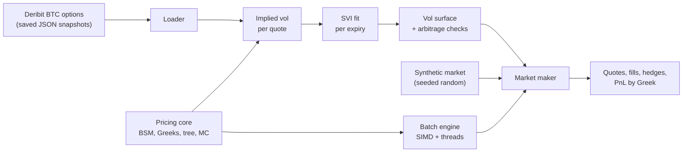
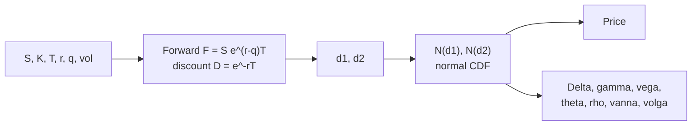
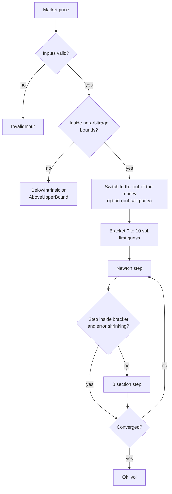
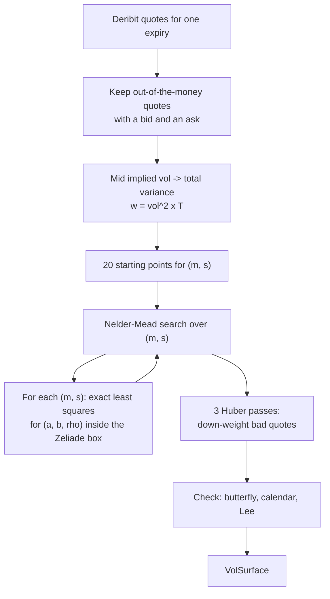
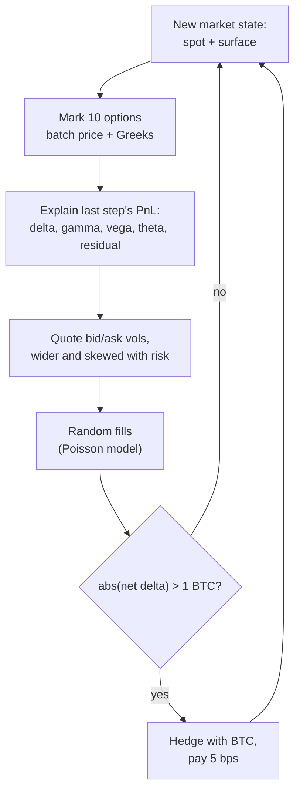

# options-engine

A fast C++20 engine that **prices options**, builds a **volatility surface** from real
Bitcoin option prices, and runs a small **market maker** on top of it.

An option is a contract that gives the right to buy (call) or sell (put) something at a fixed
price later. This project does four things with options:

1. **Prices them** and computes their risk numbers (the "Greeks") with Black-Scholes, a
   binomial tree and Monte Carlo, and turns market prices back into volatility (implied vol).
2. **Prices them fast**: about 10 ns per option on one core with hand-written SIMD code, and
   about 0.9 ns per option on 18 threads.
3. **Fits a volatility smile** (the SVI model) to real Deribit BTC option quotes and checks
   that the result has no arbitrage.
4. **Market-makes**: quotes bid and ask prices around that surface, gets filled, hedges its
   delta, and explains its profit and loss by Greek.

New here? Read the [project guide](docs/PROJECT_GUIDE.md). It explains everything in plain
language, with many diagrams.

## Results at a glance

Measured on an **Apple M5 Pro laptop (macOS, Apple clang 21)**, `release` preset, NEON SIMD
(2 doubles per instruction). The laptop was not idle, so treat speed numbers as preliminary.

| What | Result | Source |
|---|---|---|
| Price one option, standard libm version | 37.22 ns (26.87M options/s) | [benchmarks](docs/benchmarks.md#what-the-numbers-say) |
| Price one option, own fast math, one at a time | 18.7 ns (53.48M/s) | [benchmarks](docs/benchmarks.md#what-the-numbers-say) |
| Price one option, SIMD | 9.989 ns (100.1M/s), **3.73x** faster than libm | [benchmarks](docs/benchmarks.md#what-the-numbers-say) |
| Price + 5 Greeks, SIMD | 14.16 ns, 3.24x faster than libm (45.94 ns) | [benchmarks](docs/benchmarks.md#what-the-numbers-say) |
| 1,048,576 options on 18 threads | 0.8994 ns per option (1,112M prices/s) | [benchmarks](docs/benchmarks.md#what-the-numbers-say) |
| SIMD vs one-at-a-time results | bit-identical: 0 of 1,402,149 outputs differ | [accuracy](docs/accuracy.md#batch-engine-tolerances) |
| Implied vol, 44,872 well-conditioned test points | max error 1.534e-11, mean 6.22 iterations | [accuracy](docs/accuracy.md#implied-volatility-round-trip) |
| Implied vol speed | 258.1 ns per solve near the money, 381.6 ns in the wings | [benchmarks](docs/benchmarks.md#iv_bench) |
| SVI fit on a real Deribit BTC snapshot | 7 expiries, RMSE 0.2156 to 1.0629 vol points (mean 0.6935) | [accuracy](docs/accuracy.md#committed-deribit-snapshot) |
| Arbitrage checks on that surface | 0 butterfly, 0 calendar, 0 Lee violations | [part 3 log](docs/part3-verification.md#vol_surface-on-the-committed-snapshot) |
| Our vols vs Deribit's own mark vols (OTM) | median difference 0.0027 vol points | [conventions](docs/conventions.md#mark-convention-check) |
| Market maker, 1 simulated day (seed 42) | 3,539 fills, 206 hedges; PnL attribution matches an independent ledger to 5.8e-11 USD | [mm model](docs/mm_model.md#synthetic-seed-42-one-day-of-1-second-steps) |
| Quote update (price + quote 10 options) | p50 1,215 ns, p99 1,503 ns | [mm model](docs/mm_model.md#synthetic-seed-42-one-day-of-1-second-steps) |
| Heap allocations in the hot paths | 0 (batch pricing and every simulator step) | [part 4 log](docs/part4-verification.md#zero-allocation) |
| Automated tests | 181, all passing in `release`, `asan` (ASan + UBSan) and `tsan` | [part 4 log](docs/part4-verification.md#clean-builds-and-tests) |

The market maker's profit is almost all "spread capture" and is an **upper bound**: the fill
model has no adverse selection. See [docs/mm_model.md](docs/mm_model.md#fill-model).

## How it works

### The whole system



Four layers. Each one only uses the layers below it. The pricing code has no third-party
dependency; only the Deribit loader uses a JSON library.

### Pricing one option



The batch engine runs the same formula on many options at once: 2 per NEON instruction,
in tiles of 64 options, split over a thread pool for big batches.

### Implied vol solver



Newton is fast; the bracket and bisection make it always converge.

### Fitting the volatility surface



### One step of the market maker



## Quick start

You need CMake 3.25+, Ninja and a C++20 compiler (tested: Apple clang 21). The first configure
downloads GoogleTest, Google Benchmark and nlohmann/json (pinned by SHA-256). Tests run offline
on the committed data.

Build and run the tests:

```sh
cmake --preset release && cmake --build --preset release && ctest --preset release
```

Other presets: `debug`, `asan` (AddressSanitizer + UBSan), `tsan` (ThreadSanitizer),
`release-lto`.

Try the tools:

```sh
T=./build/release/tools
$T/opt_info                       # version, SIMD backend (neon / avx2+fma / scalar), compiler
$T/iv_accuracy                    # implied-vol round trip over 56,000 grid points
$T/vol_surface tests/data/deribit/BTC-20261017T123254Z --csv /tmp/surface.csv
                                  # IVs, SVI fit per expiry, arbitrage checks
$T/mm_sim --mode synthetic --seed 42 --events /tmp/events.csv
                                  # one simulated day: quotes, fills, hedges, PnL, latency
$T/mm_sim --mode recorded --series tests/data/deribit/series
                                  # the market maker on 6 real Deribit snapshots
```

Benchmarks: `caffeinate -i scripts/run_benchmarks.sh` (macOS; drop `caffeinate -i` on Linux).
New Deribit data: `scripts/fetch_deribit.sh --count 1` (needs `curl` and `jq`; public API, no
login).

## Project layout

| Folder | What is in it |
|---|---|
| `include/opt/core/` | Random numbers, normal distribution, fast exp/log/CDF, latency histogram |
| `include/opt/simd/` | NEON, AVX2 and scalar vector types behind one interface |
| `include/opt/pricing/` | Black-Scholes, Greeks, implied vol, binomial tree, Monte Carlo |
| `include/opt/batch/` | Batch engines (Reference, FastScalar, Simd), thread pool |
| `include/opt/vol/`, `include/opt/deribit/` | Market IVs, SVI fit, arbitrage checks, surface, Deribit loader |
| `include/opt/mm/` | Market maker: quoter, fills, portfolio, hedger, PnL, simulator |
| `src/` | Library sources |
| `tools/` | `opt_info`, `iv_accuracy`, `fast_math_error`, `vol_surface`, `mm_sim` |
| `tests/` | GoogleTest suites, CLI tests, committed Deribit data in `tests/data/deribit/` |
| `bench/` | Google Benchmark programs |
| `scripts/` | `fetch_deribit.sh`, `trim_snapshot.sh`, `run_benchmarks.sh` |
| `docs/` | Guide, accuracy, benchmarks, conventions, market-maker model, verification logs |

## Learn more

- [docs/PROJECT_GUIDE.md](docs/PROJECT_GUIDE.md): the full beginner-friendly guide (options
  primer, every component, design decisions, interview questions).
- [docs/accuracy.md](docs/accuracy.md): fast-math errors, implied-vol accuracy, SVI fits.
- [docs/benchmarks.md](docs/benchmarks.md): every benchmark with median and min..max.
- [docs/conventions.md](docs/conventions.md): units and Deribit conventions.
- [docs/mm_model.md](docs/mm_model.md): the market-maker model, its defaults and its biases.
- `docs/part1-verification.md` to `docs/part4-verification.md`: every command and output.

## Data note

`tests/data/deribit/` holds small snapshots of public Deribit market data (fetched
2026-10-17), so the tests and tools run offline. Read Deribit's API terms of use before
publishing this repository.
