# options-engine: project guide

This guide explains the whole repository in plain language: what an option is, what each part
of the code does, why it was built that way, how it was tested, what the numbers mean, and what
is still missing. It is written for the repo owner, who will have to explain and defend the
design in quant and low-latency C++ interviews. The code was written by AI coding agents, so
the guide points to the real files for every claim.

Every number in this guide comes from a recorded run: `docs/part1-verification.md` to
`docs/part4-verification.md`, `docs/benchmarks.md`, `docs/accuracy.md`, `docs/conventions.md`,
`docs/mm_model.md`, or a run made while writing this guide (the command is shown next to it).
**All speed numbers were measured on one Apple M5 Pro laptop (macOS) that was not idle.** No
Linux machine has been used yet, so speed numbers are preliminary.

## Table of contents

1. [Reading roadmap](#1-reading-roadmap)
2. [Project overview in pictures](#2-project-overview-in-pictures)
3. [Status: what is done and what is not](#3-status-what-is-done-and-what-is-not)
4. [Background primer](#4-background-primer)
5. [Component deep dives](#5-component-deep-dives)
6. [Key design decisions](#6-key-design-decisions)
7. [Correctness strategy](#7-correctness-strategy)
8. [Performance results](#8-performance-results)
9. [Interview prep](#9-interview-prep)
10. [Resume](#10-resume)
11. [Next steps](#11-next-steps)
12. [Glossary](#12-glossary)

---

## 1. Reading roadmap

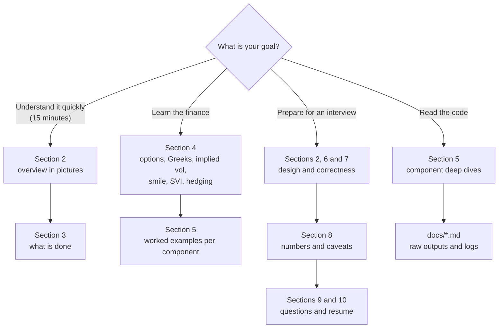

Every branch starts with pictures and plain words. The glossary (section 12) helps on any
branch.

---

## 2. Project overview in pictures

### Explain it like I'm new

1. **What an option is.** An option is a contract. A *call* gives you the right to buy
   something (here: Bitcoin, or a stock) at a fixed price, the *strike*, on a fixed date. A
   *put* gives you the right to sell. You pay a price (the *premium*) for that right today.
2. **What we compute.** How much the option is worth today, and how its value changes when the
   market moves. Those sensitivities are the *Greeks*.
3. **What we read from the market.** Real Bitcoin option prices from the Deribit exchange. From
   each price we work backwards to the *implied volatility*: how much movement the market is
   expecting.
4. **What we draw.** Implied vols differ by strike and expiry. We fit a smooth curve (the *SVI*
   model) through them for each expiry. All curves together are the *volatility surface*.
5. **What we trade.** A simulated *market maker* uses that surface to post prices to buy (bid)
   and sell (ask) 10 options, gets filled at random, removes its Bitcoin risk by *hedging*, and
   explains every dollar of profit or loss by Greek.

### An everyday analogy

Think of an option as **an insurance policy**. A put on Bitcoin at 72,000 USD is insurance that
pays if Bitcoin falls below 72,000. The insurance price depends on how likely that is, which
depends on how much Bitcoin is expected to move: the volatility. The market maker is an
**insurance shop** that sells and buys policies all day. It earns a small margin on each
policy (the spread), and it reduces its risk of a big loss by holding some Bitcoin against its
policies (the hedge).

### Picture 1: the big picture

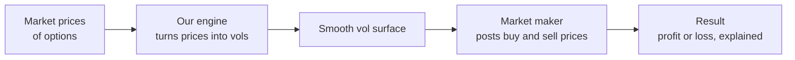

### Picture 2: the four parts, as layers

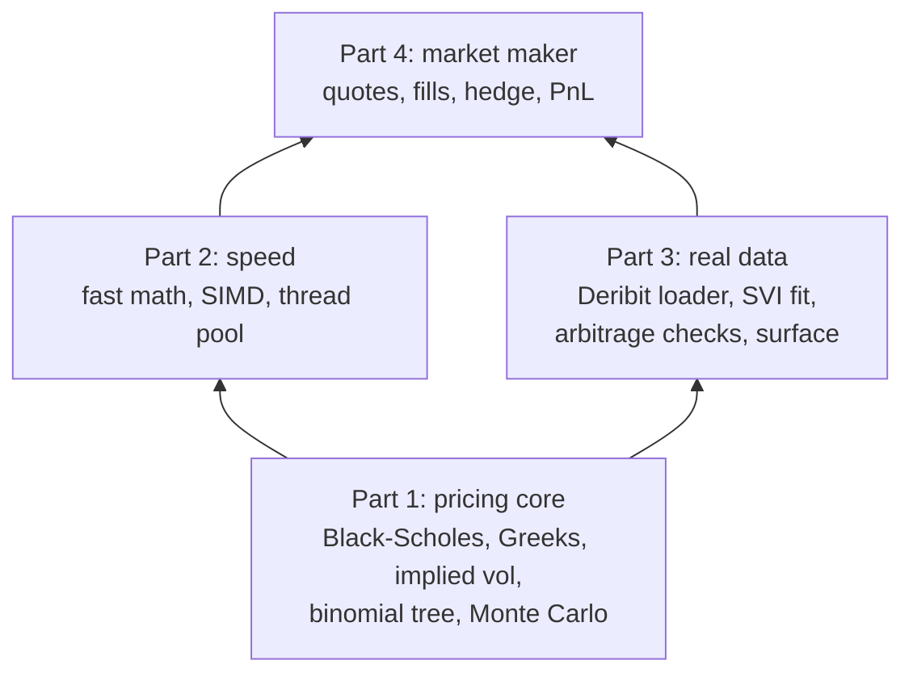

Each part only uses the parts below it. Part 2 prices many options at once with the same
formulas as Part 1. Part 3 uses the Part 1 implied-vol solver. Part 4 uses the Part 2 batch
engine to price and the Part 3 surface to know the fair vol.

### Picture 3: the libraries in the code

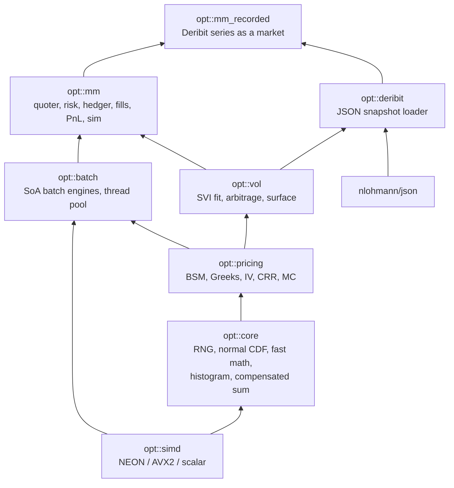

An arrow means "is used by". Only `opt::deribit` touches a third-party library (JSON). The
pricing code depends on nothing but the C++ standard library.

### Picture 4: what each tool does

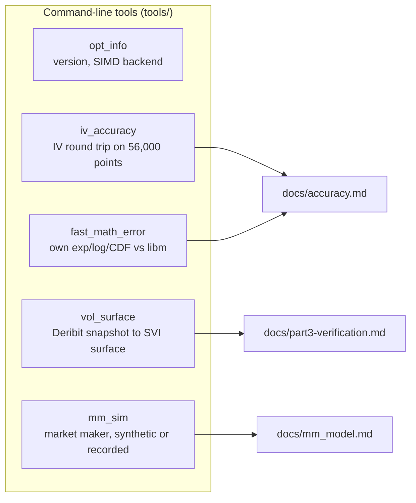

### What each part does

| Part | One-line job | Everyday analogy |
|---|---|---|
| Black-Scholes pricer | Price of an option from spot, strike, time, rate, vol | An insurance price formula |
| Greeks | How the price moves when each input moves | "How much does my premium change if..." |
| Implied vol solver | Turn a market price back into a vol | Reading the market's fear level off a price tag |
| Binomial tree | Price American options (early exercise) | A decision tree of up and down moves |
| Monte Carlo | Price by simulating many random futures | Rolling dice a million times and averaging |
| Fast math + SIMD | Price many options per CPU instruction | A cashier scanning 2 items at once |
| Thread pool | Split a big batch over all CPU cores | Opening all checkout lanes |
| Deribit loader | Read saved exchange data (JSON) | Reading a price list |
| SVI fit | Smooth curve through noisy vols | Drawing a best-fit line through dots |
| Arbitrage checks | Make sure the curve allows no free money | Checking a price list for contradictions |
| Market maker | Post bid/ask, get filled, hedge | An insurance shop that buys and sells |
| PnL attribution | Explain profit by cause | A shop's account book, by department |

### The project in numbers

> **Preliminary: measured on a macOS laptop.** Sources in [section 8](#8-performance-results).
>
> | | |
> |---|---|
> | Automated tests | 181, all passing in `release`, `asan` (ASan + UBSan) and `tsan` |
> | Price one option, SIMD (NEON) | 9.989 ns, 3.73x faster than the libm version (37.22 ns) |
> | Price 1,048,576 options on 18 threads | 0.8994 ns per option, 1,112 million per second |
> | SIMD results vs one-at-a-time results | bit-identical, 0 of 1,402,149 outputs differ |
> | Implied vol, well-conditioned points | max error 1.534e-11 over 44,872 points |
> | Implied vol speed | 258.1 ns per solve near the money |
> | SVI fit, real Deribit BTC snapshot | 7 expiries fitted, RMSE 0.2156 to 1.0629 vol points |
> | Arbitrage violations in that surface | 0 butterfly, 0 calendar, 0 Lee |
> | Market maker, one simulated day | 3,539 fills, 206 hedges, PnL explained to 5.8e-11 USD |
> | Quote update for 10 options | p50 1,215 ns, p99 1,503 ns |
> | Heap allocations in hot paths | 0 (checked by a test) |

---

## 3. Status: what is done and what is not

### Done

All four parts are implemented, reviewed (each review in `.agents/review/partN.md` ends with
"Verdict: APPROVED") and committed on `main`.

| Part | What | Commits |
|---|---|---|
| 0 | Build scaffold, presets, CI file, RNG, `opt_info` | `3c95898`, `9f69236` |
| 1 | BSM and Greeks, implied vol, CRR tree, Monte Carlo, accuracy docs | `e4246ed`, `ae0f000`, `703617b`, `a2d734b`, `5d19900` |
| 2 | SIMD engines, fast math, thread pool, benchmarks | `f2ce680`, `8ce3331` |
| 3 | Deribit scripts and data, loader, SVI fit, arbitrage, surface | `0c4e947`, `84bb0ba`, `8b27091` |
| 4 | Market maker simulator, `mm_sim`, model docs | `00bb3bc`, `5f62146` |
| 5 | README and this guide | the docs commit after `5f62146` |

Final check while writing this guide: `release`, `asan` and `tsan` each configured and built
from a deleted build directory with 0 compiler warnings, and `ctest` passed 181 of 181 in each
(details in [section 7](#final-verification-run)).

### Not done (honest list)

- **No Linux or GCC run yet.** The CI file (`.github/workflows/ci.yml`, GCC and Clang on Ubuntu)
  exists but has not run, because nothing is pushed. The claim that the golden market-maker run
  is bit-identical across compilers is tested only on Apple clang so far.
- **AVX2 was checked only under Rosetta 2** (an x86_64 build run on the Mac), not on a real x86
  CPU.
- **The SVI fit keeps a >= 0**, which is too strict for BTC smiles and costs fit quality (see
  [5.10](#510-svi-fit)).
- **The fill model has no adverse selection**, so the market maker's profit is an upper bound.
- Review findings left open (all non-blocking) are listed in [section 11](#11-next-steps).

---

## 4. Background primer

This section teaches the finance you need, with small numbers you can check. Worked examples
marked "measured" come from a scratch program that calls the library
(`/tmp/oe-guide/guide_examples.cpp`, linked against `build/release/src/*.a`, run once while
writing this guide). Its output is pasted as printed.

### 4.1 Options, calls and puts

- **Spot** S: today's price of the underlying (a stock, or Bitcoin).
- **Strike** K: the fixed price in the contract.
- **Expiry** T: when the option ends, in years.
- **Call** payoff at expiry: max(S_T - K, 0). You buy at K only if S_T is higher.
- **Put** payoff at expiry: max(K - S_T, 0). You sell at K only if S_T is lower.
- **European** options can only be exercised at expiry. **American** options can be exercised
  any time before. Deribit options are European. The binomial tree prices American ones.

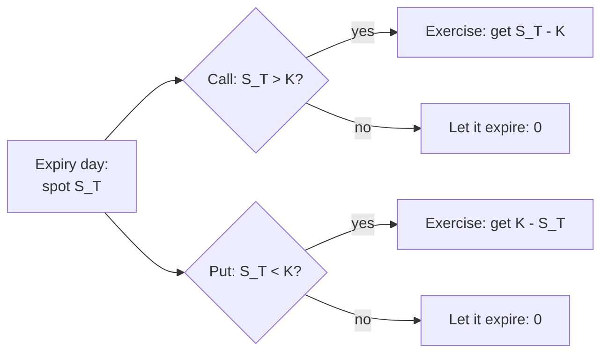

### 4.2 Moneyness

- **In the money (ITM)**: exercising now would pay (a call with S > K).
- **At the money (ATM)**: S close to K.
- **Out of the money (OTM)**: exercising now would pay nothing (a call with S < K).
- Price = **intrinsic value** (what exercising now pays) + **time value** (the chance it gets
  better before expiry).
- The code uses **log-moneyness** k = ln(K/F), where F is the forward (below). k = 0 is ATM,
  k > 0 is a higher strike.

Measured, S = 100, T = 1, r = 0.05, vol = 0.20, calls:

```
K 80: call 24.5888 (intrinsic 20.00, time value 4.5888) delta 0.9286 vega/volpt 0.1363
K 100: call 10.4506 (intrinsic 0.00, time value 10.4506) delta 0.6368 vega/volpt 0.3752
K 120: call 3.2475 (intrinsic 0.00, time value 3.2475) delta 0.2872 vega/volpt 0.3407
```

Time value is largest at the money, and so is vega (sensitivity to vol).

### 4.3 Black-Scholes, by intuition

Black-Scholes(-Merton) assumes the log of the price moves randomly with a constant volatility
sigma. Under that assumption there is one fair price, because a trader could copy the option's
payoff by holding the right amount of the underlying and adjusting it continuously.

The code uses the **forward form**. Two helper numbers:

- Forward F = S e^{(r - q) T}: the fair price today for delivery at T (r = interest rate,
  q = dividend or carry yield).
- Discount D = e^{-rT}: what 1 dollar at T is worth today.

Then, with omega = +1 for a call and -1 for a put, sd = sigma sqrt(T):

- d1 = (ln(F/K) + sd^2 / 2) / sd, d2 = d1 - sd
- price = D omega (F N(omega d1) - K N(omega d2)), where N is the normal CDF.

In words: N(d2) is roughly the chance the call ends in the money, and F N(d1) is the expected
value of the stock in those cases. The price is the discounted expected payoff.

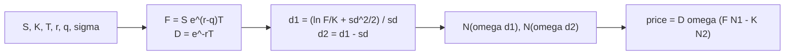

Measured check, S = K = 100, T = 1, r = 0.05, q = 0, vol = 0.20:

```
price 10.4506 delta 0.6368 gamma 0.01876 vega/volpt 0.3752 theta/day -0.01757 rho 53.2325
ATM put: price 5.5735 delta -0.3632 gamma 0.01876 vega/volpt 0.3752 theta/day -0.00454
parity: c - p = 4.8771, S - K e^-rT = 4.8771
```

The last line is **put-call parity**: c - p = S e^{-qT} - K e^{-rT}, true for any model. The
test `BlackScholes.PutCallParity` checks it on 10,000 random points: max error 3.9e-16 x (S + K)
(`docs/part1-verification.md`).

### 4.4 The Greeks, each with a worked example

Each Greek says how the price changes when one input moves. The worked numbers below bump one
input of the ATM call above (price 10.4506) and compare the real change with the Greek's
prediction. All measured.

| Greek | Meaning | Bump | Real change | Greek predicts |
|---|---|---|---|---|
| Delta | dV/dS: change per 1 unit of spot | spot 100 -> 101 | +0.6461 | delta 0.6368; with gamma: 0.6368 + 0.01876/2 = 0.6462 |
| Gamma | d2V/dS2: how fast delta changes | (same bump) | delta rises by about 0.019 per unit | 0.01876 |
| Vega | dV/dsigma, printed per vol point (0.01) | vol 0.20 -> 0.21 | +0.3757 | 0.3752 |
| Theta | dV/dt, printed per day | one day passes | -0.01758 | -0.01757 |
| Rho | dV/dr per 1.00 of rate | rate 0.05 -> 0.06 | +0.5390 | 0.5323 (rho / 100) |

```
spot 101: price 11.0967 change 0.6461  delta guess 0.6368  delta+gamma/2 guess 0.6462
vol 0.21: price 10.8263 change 0.3757  vega/100 guess 0.3752
one day later: price 10.4330 change -0.01758  theta/365 guess -0.01757
rate 0.06: price 10.9895 change 0.5390  rho/100 guess 0.5323
```

What to remember:

- **Delta** is the hedge ratio: to remove spot risk of a long call, sell 0.6368 units of the
  underlying.
- **Gamma** is why delta alone is not enough: the delta-only guess misses 0.0093 of the 0.6461
  move; adding gamma/2 gets within 0.0001.
- **Vega** is largest at the money (table in 4.2).
- **Theta** is the daily cost of owning time value. A long option loses about 0.018 per day here.
- **Vanna** (d2V/dS dsigma) and **volga** (d2V/dsigma2) are second-order. The code computes them;
  the market maker's PnL attribution leaves them in the "residual" bucket.

Units are fixed in one place (`docs/conventions.md`): vega per 1.00 of vol (tools divide by 100),
theta per year (tools divide by 365). Interviewers like to ask about units, so know this table.

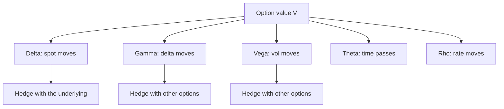

### 4.5 Implied volatility

Every input to Black-Scholes is visible in the market except sigma. So traders run the formula
backwards: given a market price, find the sigma that gives that price. That is the **implied
volatility (IV)**. Prices are quoted in vol because vol is comparable across strikes and
expiries.

Measured: give the solver the ATM call price from 4.3 and ask for sigma.

```
input price 10.4505835722 -> vol 0.200000000000000 status 0 iterations 4 error 2.776e-17
call K=80 price 19.00 (intrinsic-ish bound 23.9016) -> status 2
```

The first line recovers 0.20 in 4 Newton steps. The second asks for the vol of a call priced at
19.00 when it must be worth at least S - K e^{-rT} = 23.9016; no vol can do that, so the solver
returns status 2 (`BelowIntrinsic`) instead of a wrong number.

**Conditioning** is the key idea: a price error dP becomes a vol error dP / vega. Far out of the
money or very close to expiry, vega is tiny, so even a perfect solver cannot recover sigma
precisely from a double-precision price (`docs/accuracy.md`).

### 4.6 The smile and the surface

If Black-Scholes were exactly right, every option on Bitcoin would have the same IV. In reality
IV depends on strike (the **smile** or **skew**) and on expiry (the **term structure**). All of
them together are the **volatility surface**.

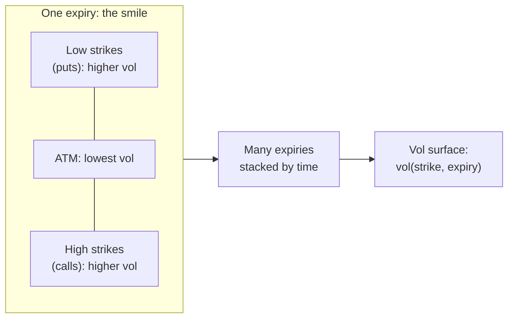

Real example (`vol_surface` on the committed snapshot, 19OCT26 slice, 1.81 days): the fitted
smile is 21.17% at the money, 58.10% at k = -0.10 and 34.12% at k = +0.10 (from the
measured SVI values in [4.7](#47-svi-a-formula-for-the-smile)). The left side is higher: the
market pays more for crash insurance.

### 4.7 SVI: a formula for the smile

SVI ("stochastic volatility inspired", Gatheral 2004) describes one smile in **total variance**
w = sigma^2 T as a function of log-moneyness k:

w(k) = a + b (rho (k - m) + sqrt((k - m)^2 + s^2))

| Parameter | Meaning in pictures |
|---|---|
| a | overall level (vertical shift) |
| b | how steep the wings are |
| rho | tilt: negative means the left (put) side is higher |
| m | where the bottom of the smile sits (horizontal shift) |
| s | how rounded the bottom is |

Measured, the 19OCT26 fit from `vol_surface` (a = 1.52e-20, b = 0.0123428, rho = -0.623684,
m = -0.0184241, s = 0.0230447, tau = 0.004960):

```
k -0.10: w 1.674252e-03  vol 58.10%  g 0.1207
k -0.05: w 7.255622e-04  vol 38.25%  g 0.1004
k +0.00: w 2.223372e-04  vol 21.17%  g 1.1276
k +0.05: w 3.644274e-04  vol 27.11%  g 0.5243
k +0.10: w 5.774732e-04  vol 34.12%  g 0.3747
min w 2.223371e-04
```

`g` is the butterfly test value of 4.8; every g is positive, so this slice has no butterfly
arbitrage on these points.

### 4.8 Arbitrage: why a surface can be "wrong"

**Arbitrage** is free money: a trade that cannot lose and might win. A good surface must not
allow it. Three checks (`src/vol/arbitrage.cpp`):

- **Butterfly** (within one expiry): buying the K-h and K+h calls and selling two K calls must
  never cost less than zero. For SVI this is the test g(k) >= 0 (Gatheral and Jacquier 2014).
- **Calendar** (between expiries): at the same k, total variance must grow with expiry:
  w_2(k) >= w_1(k). Otherwise a longer option would be cheaper than a shorter one.
- **Lee wing slopes**: far in the wings, total variance can grow at most like 2 |k|
  (Lee's moment formula). The code prints b(1 + rho) and b(1 - rho) and flags values above 2.

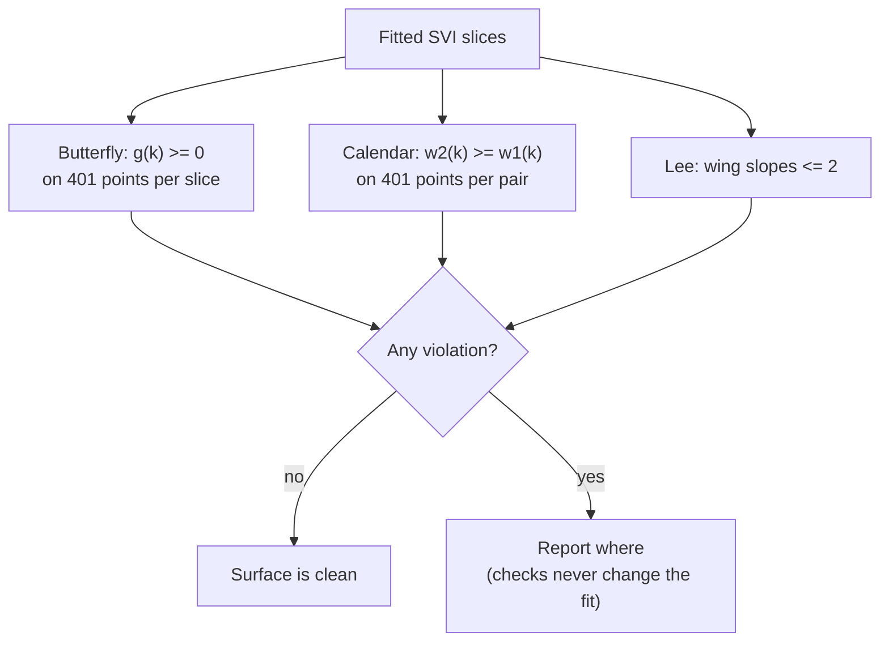

### 4.9 Delta hedging

A market maker does not want to bet on direction. After each trade it computes the portfolio's
**net delta** (sum of position x delta, plus the hedge) and, if it is too large, trades the
underlying to bring it back to zero. Here: hedge when |net delta| > 1 BTC, at a cost of 5 basis
points (0.05%) of the traded notional.

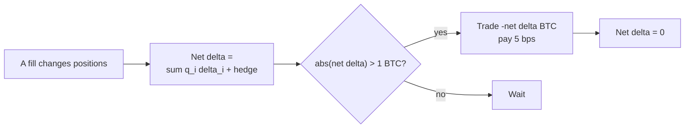

Delta hedging removes first-order spot risk only. The hedged book still has gamma (it gains or
loses on big moves), vega (vol changes) and theta (time decay).

### 4.10 PnL attribution

After every step, the simulator explains the change in value by cause, using the Greeks from the
start of the step (dS = spot change, dsigma = each option's own vol change at its strike, dt in
years):

| Bucket | Formula |
|---|---|
| delta | (sum q_i delta_i + hedge) dS |
| gamma | 1/2 sum q_i gamma_i dS^2 |
| vega | sum q_i vega_i dsigma_i |
| theta | sum q_i theta_i dt |
| residual | actual change minus the four above (vanna, volga, higher order) |
| spread capture | per fill: how much better than fair value we traded |
| hedge cost | 5 bps per hedge, subtracted |

The check that makes this trustworthy: an **independent ledger** (cash plus the value of all
positions) must equal the sum of the buckets. In the one-day synthetic run they agree to
5.821e-11 USD with a tolerance of 2.493e-05 USD (`docs/mm_model.md`).

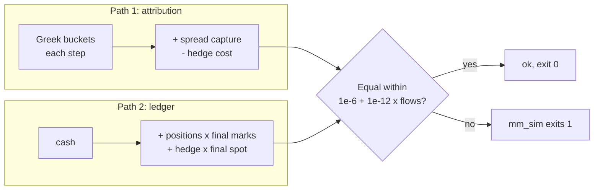

---

## 5. Component deep dives

Each component has: **what** it does, **why** it exists, **how** it works (with a short real
code excerpt), a worked example or measured result, and a flowchart.

### 5.1 Core building blocks (`include/opt/core/`)

**What.** Random numbers (`rng.hpp`: SplitMix64 for seeding, xoshiro256++ for draws), the normal
distribution (`normal.hpp`: `norm_cdf` via `erfc`, `norm_inv_cdf` via Wichura's AS241),
compensated summation (`compensated_sum.hpp`: Neumaier), and the latency histogram copied from
the sibling project `itch-pipeline`.

**Why.** Everything else needs them, and each must be reproducible: same seed, same numbers, on
every platform.

**How.** `norm_cdf(x) = 0.5 erfc(-x / sqrt 2)`, never `1 - cdf`, so tiny lower-tail values keep
their digits. `uniform01` returns a value strictly inside (0, 1) so `log` and the inverse CDF
never see 0 or 1. The RNG test values come from the authors' own C code, compiled separately,
not from this code.

**Measured.** `Normal.CdfSymmetry`: max |N(x) + N(-x) - 1| = 0. AS241 round trip: within the
bound (coefficient 4.01 measured, bound 6; the design said 4, explained in `docs/accuracy.md`).

### 5.2 Fast math (`include/opt/core/fast_math.hpp`)

**What.** Own versions of exp, log, the normal CDF and PDF, written as templates on a "lane"
type `V` (a plain `double` or a SIMD vector).

**Why.** libm's `exp` cannot work on two or four values at once, and it differs by an ulp
between Apple and glibc. Our own functions use only correctly rounded IEEE operations (+ - * /
sqrt fma and bit casts), so every backend gives the **same bits**.

**How.** `fast_exp` splits x = n ln 2 + r, evaluates a degree-13 polynomial for e^r with `fma`,
and scales by 2^n with a bit trick (no integer conversion instruction, which AVX2 lacks):

```cpp
const V n = fm::round_nearest(xc * bcast<V>(fm::kInvLn2));
V r = simd::fma(-n, bcast<V>(fm::kLn2Hi), xc);
r = simd::fma(-n, bcast<V>(fm::kLn2Lo), r);
V p = bcast<V>(1.0 / 6227020800.0);  // 1/13!
p = simd::fma(p, r, bcast<V>(1.0 / 479001600.0));
// ... down to 1.0
const V n1 = fm::round_nearest(n * bcast<V>(0.5));
const V n2 = n - n1;
V res = (p * fm::pow2i(n1)) * fm::pow2i(n2);
```

`round_nearest(x)` is `(x + 0x1.8p52) - 0x1.8p52`: adding 1.5 x 2^52 pushes the fraction bits
out, so the hardware rounds for us.

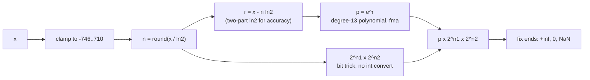

**Measured** (`./build/release/tools/fast_math_error`, 10,000,000 points per row, vs libm):

| Function | Max relative error |
|---|---|
| `fast_exp` on [-708, 709] | 2.220e-16 (1 eps) |
| `fast_log` on [1e-300, 1e300] | 3.814e-16 |
| `fast_norm_cdf` on [0, 9] | 4.440e-16 |
| `fast_norm_cdf` on [-37, -7.07] | 8.912e-09 (absolute error at most 2.775e-21) |

The normal CDF is accurate in absolute terms (2.22e-16 everywhere) but not in relative terms
deep in the lower tail. That is a property of the published West (2005) approximation, not a
bug; the test bound was changed with the reason written down (`docs/accuracy.md`). One honest
point: Apple's `std::exp` (1.802 ns) is faster than `fast_exp` (2.227 ns) one call at a time.
The win comes from SIMD.

### 5.3 Black-Scholes price and Greeks (`src/pricing/black_scholes.cpp`)

**What.** `bsm_price`, `bsm_greeks` (spot form) and `black76` (forward form, used for Deribit).
This is the **Reference** path: libm functions, every edge case defined.

**Why.** It is the oracle: every faster engine is compared against it.

**How.** One formula with omega = +1 / -1, so calls and puts share code with no branch:

```cpp
const double d1 = (std::log(fwd / strike) + 0.5 * sd * sd) / sd;
const double d2 = d1 - sd;
const double nd1 = norm_cdf(w * d1);
const double nd2 = norm_cdf(w * d2);
const double pdf = norm_pdf(d1);
g.price = disc * std::max(w * (fwd * nd1 - strike * nd2), 0.0);
g.delta = w * disc_q * nd1;
```

Edge cases are defined, not left to NaN: T = 0 gives intrinsic value, sigma = 0 gives the
discounted forward intrinsic, and at exactly the money delta is 0.5 omega. Deep OTM puts are
computed from N(-d), never through put-call parity (which would subtract two nearly equal
numbers).

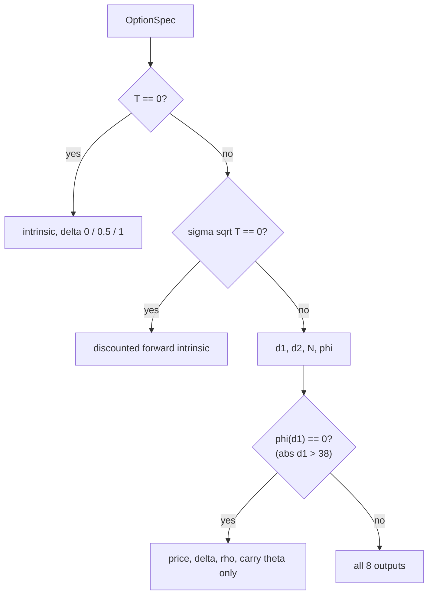

**Measured** (`docs/part1-verification.md`): Hull example 15.6 gives c = 4.759422, p = 0.808599
(book: 4.76, 0.81). Greeks vs finite differences on 2,000 random points: worst error / tolerance
0.547 (volga).

### 5.4 Implied vol solver (`src/pricing/implied_vol.cpp`)

**What.** `implied_vol_black(type, price, F, K, T, D)` returns `{vol, status, iterations}`.

**Why.** Part 3 turns every Deribit price into a vol; a solver that can fail silently or loop
forever would corrupt the whole surface.

**How.** Six steps:

1. Validate inputs (else `InvalidInput`).
2. Check no-arbitrage bounds (else `BelowIntrinsic` / `AboveUpperBound`).
3. Switch an ITM option to the OTM one with the same strike (put-call parity), which is better
   conditioned.
4. Bracket [0, 10]: if even vol 10 is too cheap, `AboveMaxVol`.
5. First guess: Corrado-Miller, else a wing formula, else Brenner-Subrahmanyam.
6. Safeguarded Newton: take the Newton step if it stays inside the bracket and the error halved
   compared with two iterations ago; otherwise bisect.

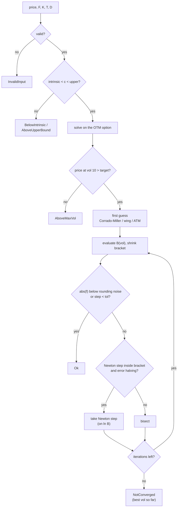

The core of step 6:

```cpp
const double gv = b > 0.0 ? std::log(b) - log_target : kNaN;
if (vega >= 1e-300 && b > 0.0) {
  const double newton = vol - gv * (b / vega);
  ...
  const bool inside = newton > lo && newton < hi;
  const bool halving = std::abs(gv) <= 0.5 * abs_g_prev2;
  if (inside && halving) next = newton;
}
if (std::isnan(next)) next = 0.5 * (lo + hi);
```

Three measured improvements over the design (each explained in `docs/accuracy.md`): Newton on
ln B instead of B (B is very convex in the wings), a wing first guess, and a stop when |f| is
below the formula's own rounding noise.

**Measured** (`./build/release/tools/iv_accuracy`, 56,000 grid points): on 44,872
well-conditioned points, max vol error 1.534e-11 (tolerance 1e-10), mean 6.22 iterations, max 12,
all status Ok. Over all 55,963 Ok points: mean 6.25 iterations, max 49. Speed (`iv_bench`):
258.1 ns per solve near the money (mean 4.532 iterations), 381.6 ns in the wings (6.016).
Hull 15.11: implied vol 0.234513 in 4 iterations (book 0.235).

### 5.5 Binomial tree (`src/pricing/binomial.cpp`)

**What.** Cox-Ross-Rubinstein tree: N steps, each step spot goes up by u = e^{sigma sqrt(dt)} or
down by 1/u. Prices European and American options.

**Why.** Black-Scholes has no formula for American options. The tree handles early exercise:
at each node, value = max(hold, exercise now).

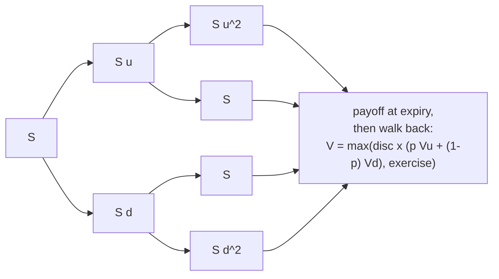

**How.** One array of N + 1 values, rolled backwards (O(N) memory, O(N^2) time). Node spots
are computed in log space and clamped to [e^-700, e^700], after a review found that the
original repeated multiplication underflowed for large sigma sqrt(T N). Calls past the clamp
return `VolTooHigh` instead of a wrong price.

**Measured** (`docs/part1-verification.md`): Hull 21.1 American put = 4.488459 (book 4.49). The
error vs Black-Scholes falls as 1/N: ratios e(4N)/e(N) of 0.2500 to 0.2502 in five ATM cases.
Speed (`tree_mc_bench`): European 241,428 ns at 2,000 steps, American 1.381e6 ns.

### 5.6 Monte Carlo (`src/pricing/monte_carlo.cpp`)

**What.** Simulates S_T = F exp(-sigma^2 T / 2 + sigma sqrt(T) Z) many times and averages the
discounted payoff, with a standard error.

**Why.** It is the general method that works for any payoff; here it validates Black-Scholes and
demonstrates variance reduction.

**How.** Normals from `norm_inv_cdf(uniform01(rng))` (one uniform per normal, so antithetic
pairs are exact). Two variance reductions: **antithetic** pairs (use Z and -Z) and a **control
variate** (the discounted S_T, whose true mean is known). Means and co-moments are updated with
Welford's one-pass formulas, which do not cancel catastrophically:

```cpp
const double dx = x - mean_x;
mean_x += dx / count;
const double dy = y - mean_y;
mean_y += dy / count;
m2_x += dx * (x - mean_x);
m2_y += dy * (y - mean_y);
c_xy += dx * (y - mean_y);
...
result.beta = cov / var_x;
result.price = mean_y - result.beta * (mean_x - expected_x);
```

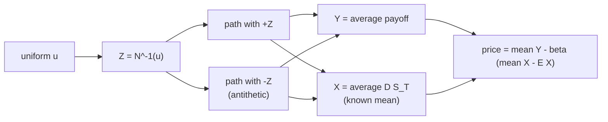

**Measured** (`MonteCarlo.EachVarianceReductionHelps`, 200,000 paths): standard error 3.317e-02
plain, 2.343e-02 antithetic (1.42x smaller), 1.260e-02 control variate (2.63x), 6.259e-03 both
(5.30x). Coverage: 3 of 50 seeds outside 2 standard errors (about 2.3 expected).

### 5.7 Batch engines and SIMD (`include/opt/batch/`, `include/opt/simd/`)

**What.** `price_batch(engine, batch, out)` and `greeks_batch(...)` over a
**structure of arrays** (one array per input: all spots, then all strikes, ...). Three engines:

| Engine | What it runs |
|---|---|
| Reference | a loop over `bsm_greeks` (libm) |
| FastScalar | the shared kernel with `V = double` (own fast math), one option at a time |
| Simd | the same kernel with `V = F64x2` (NEON, 2 options per instruction) or `F64x4` (AVX2) |

**Why.** Pricing a whole option chain (thousands of strikes) every time the market moves is the
hot loop of any options desk.

**How.** One kernel template, `include/opt/batch/kernel.hpp`, compiled for each lane type. The
range is cut into **tiles of 64 options**, and each tile runs in stages, keeping intermediate
values in small stack arrays:

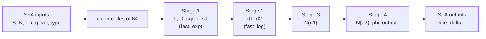

Why stages: each `fast_exp` is a chain of about 15 dependent `fma` operations. One option at a
time gives the CPU one chain; a stage over 64 options gives it 32 independent NEON chains to
overlap. In quick single runs, this took the Simd engine from 18 to 20 ns per option to about
10 (`docs/part2-verification.md`). The stage-1 code:

```cpp
for_lanes<V>(m, [&]<class L>(std::size_t j) {
  const std::size_t i = i0 + j;
  const L t = ld<L>(in.time.data() + i);
  const L r = ld<L>(in.rate.data() + i);
  const L q = ld<L>(in.carry_yield.data() + i);
  simd::store(s.fwd + j, ld<L>(in.spot.data() + i) * fast_exp((r - q) * t));
  simd::store(s.disc + j, fast_exp(-r * t));
  ...
});
```

`for_lanes` runs full vectors first, then the leftover options with `L = double`. Because every
backend runs exactly the same IEEE operations, the result does not depend on the lane width.

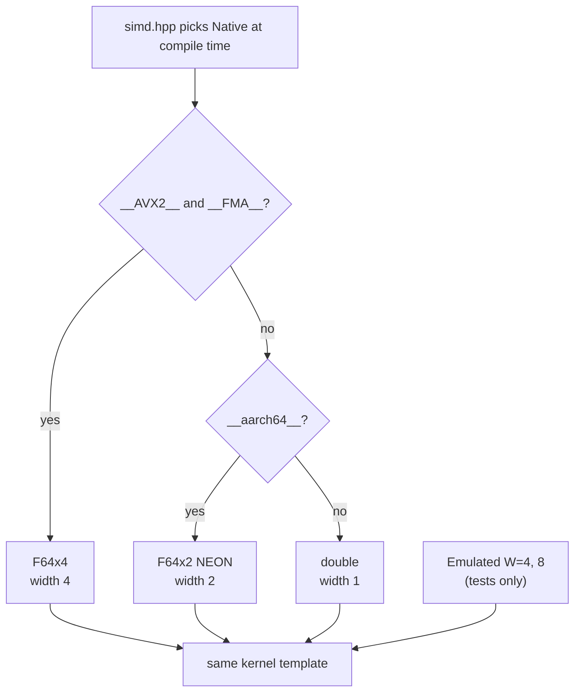

**Measured** (`docs/benchmarks.md`, n = 4,096, median of 5):

| Engine | Price, ns/option | Price + Greeks, ns/option |
|---|---|---|
| Reference | 37.22 | 45.94 |
| FastScalar | 18.7 | 26.65 |
| Simd (NEON) | 9.989 | 14.16 |

Simd is 3.73x faster than Reference for prices and 1.87x faster than FastScalar (close to the
2x a 2-wide vector allows). Results: Simd vs FastScalar **0 of 1,402,149 outputs differ** (bit
for bit). Every engine is within 4.837e-2 of its tolerance vs Reference on 200,307 test options
(`docs/accuracy.md`). The AVX2 build, run under Rosetta 2, printed the same
`0 of 1402149 outputs not bit-identical`.

### 5.8 Thread pool (`src/batch/thread_pool.cpp`)

**What.** `ThreadedPricer(threads)` splits a batch into chunks of 4,096 options and prices them
on a persistent pool of `threads - 1` workers plus the calling thread.

**Why.** Creating threads per call costs tens of microseconds. A pool created once costs nothing
per call, allocates nothing, and uses all cores.

**How.** The caller publishes a job (function pointer, context, chunk count, generation number)
under a mutex, wakes the workers, and everyone claims chunk numbers from one atomic counter:

```cpp
void ThreadPool::claim_chunks(ChunkFn fn, void* ctx, std::size_t chunks) noexcept {
  for (;;) {
    const std::size_t i = next_chunk_.fetch_add(1, std::memory_order_relaxed);
    if (i >= chunks) return;
    fn(ctx, i);
  }
}
```

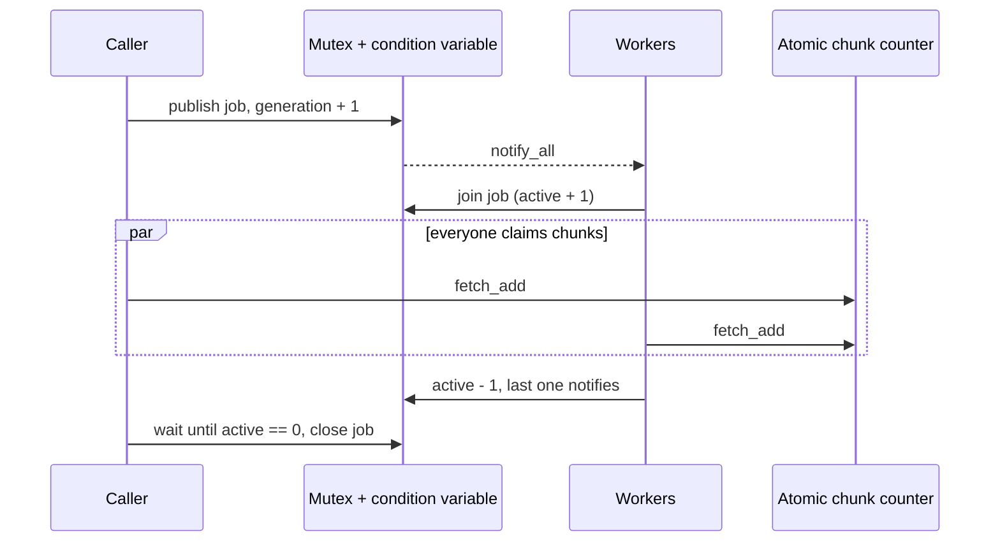

Dynamic claiming (instead of equal slices) matters because the M5 Pro mixes core types: 6
cores in performance level 0 and 12 in level 1 (sysctl). Fast cores simply take more chunks.
`fn` is a plain function pointer plus `void*`, so no `std::function` allocation. Shutdown uses
`std::jthread` stop tokens. Tested under ThreadSanitizer with no report.

**Measured** (`docs/benchmarks.md`, n = 1,048,576, prices):

| Threads | ns/option | Speed-up vs 1 thread |
|---|---|---|
| 1 | 10.18 | 1x |
| 2 | 5.169 | 1.97x |
| 4 | 2.721 | 3.74x |
| 8 | 1.561 | 6.5x |
| 18 | 0.8994 | 11.3x |

At n = 4,096 there is only one chunk, so extra threads only add wake-up cost: 18.85 ns/option
with 18 threads vs 10.08 with 1. A review flagged this (run single-chunk jobs on the caller);
it is open.

### 5.9 Deribit data: fetch, trim, load, implied vols

**What.** `scripts/fetch_deribit.sh` saves the public Deribit BTC option chain as JSON;
`scripts/trim_snapshot.sh` keeps only the needed fields and expiries; `load_snapshot` reads it;
`compute_market_ivs` computes bid, ask, mid and mark IVs.

**Why.** A vol surface from real data is what desks actually work with. Committing small
snapshots makes the tests offline and reproducible.

```mermaid
flowchart LR
  API["Deribit public API<br/>(HTTPS GET, no login)"] --> FE["fetch_deribit.sh<br/>curl + jq"]
  FE --> RAW["data/deribit/<br/>(gitignored)"]
  RAW --> TR["trim_snapshot.sh"]
  TR --> TD["tests/data/deribit/<br/>(committed, 240 KB)"]
  TD --> LD["load_snapshot<br/>(nlohmann/json)"]
  LD --> IV["market IVs<br/>Black-76 on price_btc x F"]
  IV --> SEL["fit points:<br/>OTM, bid and ask, bid > 0"]
  SEL --> FIT["SVI fit per expiry"]
```

**How (the conventions).** Deribit options are **inverse**: quoted and settled in BTC. The USD
price is price_btc x F, where F is that expiry's forward (`underlying_price`). The model is
Black-76 on that USD price with r = 0, and time is ACT/365 in milliseconds, 24/7
(`docs/conventions.md`). Bad rows are skipped and counted by reason, never silently.

**Measured** (`vol_surface` on `tests/data/deribit/BTC-20261017T123254Z`, 524 quotes, 8
expiries): our vol recomputed from Deribit's own mark price agrees with Deribit's `mark_iv` to a
median of 0.0027 vol points on 256 OTM quotes (p95 0.0063). `mark_iv` is printed to 0.01%, so
0.005 vol points is its own rounding. That is the evidence the conventions are right. ITM marks
differ more (max 12.4881 vol points), because an ITM price is mostly intrinsic value and its
1e-8 BTC rounding is a large vol error. That is why the fit uses OTM quotes only.

### 5.10 SVI fit

**What.** `fit_svi(k, w, tau)` fits the five SVI parameters to one expiry's total variances.

**Why.** Raw mid vols are noisy and have gaps; the market maker needs a smooth vol at any strike.

**How.** The **Zeliade quasi-explicit** method. For fixed (m, s), SVI is *linear* in three
numbers (a, c = b s, d = rho b s), so the best (a, c, d) is an exact small least-squares problem
inside a box of 8 linear constraints. Only (m, s) need a search, done by Nelder-Mead from 20
starting points. Then 3 Huber passes down-weight quotes that sit far from the curve.

```mermaid
flowchart TD
  P["OTM points: k_i, w_i = iv_mid^2 tau"] --> G["5 x 4 grid of starts<br/>m over data range, s in 0.01..0.5"]
  G --> NM["Nelder-Mead over (m, ln s)"]
  NM --> IN["inner problem for this (m, s):<br/>3-variable least squares"]
  IN --> FE{"unconstrained answer<br/>inside the Zeliade box?"}
  FE -- yes --> OBJ["objective"]
  FE -- no --> AS["try every set of 1, 2, 3<br/>active constraints (92 solves),<br/>keep the best feasible"]
  AS --> OBJ
  OBJ --> NM
  NM --> BEST["best of 20 starts"]
  BEST --> HU["3 Huber passes:<br/>weight = min(1, delta / abs residual),<br/>restart Nelder-Mead"]
  HU --> RES["SviParams, RMSE in vol points, status"]
```

The constraint box (`src/vol/svi_fit.cpp`):

```cpp
{{0.0, -1.0, 0.0}, 0.0},     // c >= 0
{{0.0, 1.0, 0.0}, four_s},   // c <= 4s
{{0.0, -1.0, 1.0}, 0.0},     // d <= c
{{0.0, -1.0, -1.0}, 0.0},    // -d <= c
{{0.0, 1.0, 1.0}, four_s},   // d <= 4s - c
{{0.0, 1.0, -1.0}, four_s},  // -d <= 4s - c
{{-1.0, 0.0, 0.0}, 0.0},     // a >= 0
{{1.0, 0.0, 0.0}, a_max},    // a <= max w
```

**Measured.** On synthetic smiles (41 points, tau = 1), the fit recovers the true parameters to
at most 4.49e-12, RMSE at most 6.35e-12 vol points. With 0.1 vol point noise, RMSE 0.0985 to
0.1046 (it absorbs no more than the noise). With one +10 vol point outlier, error on the clean
points is 0.4450 vol points for plain least squares and 0.0617 with Huber (`docs/accuracy.md`).

On the real snapshot (`vol_surface`, `docs/part3-verification.md`):

| Expiry | Days | Points | RMSE (vol pts) | Max error (vol pts) |
|---|---|---|---|---|
| 18OCT26 | 0.81 | 9 | not fitted (under 1 day) | |
| 19OCT26 | 1.81 | 17 | 0.7844 | 1.8791 |
| 20OCT26 | 2.81 | 23 | 0.5064 | 1.1907 |
| 21OCT26 | 3.81 | 24 | 0.7376 | 2.8417 |
| 23OCT26 | 5.81 | 19 | 1.0629 | 3.5133 |
| 30OCT26 | 12.81 | 45 | 0.9657 | 5.2648 |
| 6NOV26 | 19.81 | 18 | 0.2156 | 0.5944 |
| 27NOV26 | 40.81 | 48 | 0.5821 | 2.2295 |

Mean RMSE 0.6935 vol points. 45 of the 194 fit points (23%) have a fitted vol outside their
bid-ask range. **Known weakness:** every fit ends with a on its lower bound 0. BTC smiles want
a < 0, which raw SVI allows (only a + b s sqrt(1 - rho^2) >= 0 is needed). A scratch experiment
with the bound relaxed lowered every RMSE (19OCT26 0.7844 -> 0.3715) with no butterfly
violation; it is not in the code because it changes the design.

### 5.11 Arbitrage checks and the surface (`src/vol/arbitrage.cpp`, `src/vol/surface.cpp`)

**What.** `butterfly_check`, `calendar_check` (no allocation, used in the simulator's hot loop)
and `check_surface` (builds a report). `VolSurface` stores fitted slices and answers
`vol(strike, tau)`.

**How.** Between expiries the surface interpolates **total variance linearly in time** at fixed
k, which keeps calendar monotonicity if the slices have it; ln F is interpolated the same way.

```mermaid
flowchart LR
  Q["vol(K, tau)?"] --> F["ln F(tau): linear between slices"]
  F --> K["k = ln K - ln F"]
  K --> W{"tau between<br/>slices i and i+1?"}
  W -- yes --> L["w = w_i(k) + (w_i+1(k) - w_i(k)) x fraction"]
  W -- "before first / after last" --> E["w = w_edge(k) x tau / tau_edge<br/>(constant vol)"]
  L --> V["vol = sqrt(w / tau)"]
  E --> V
```

**Measured** (committed snapshot): 0 butterfly violations (smallest g 0.08682 on 19OCT26), 0
calendar violations in 6 adjacent pairs, largest wing slope 0.110 (Lee limit 2). On the raw
12-expiry chain (not committed) the check found one real calendar crossing far in the left wing
of the two longest expiries (25JUN27 -> 24SEP27, min w2 - w1 = -0.01631 at k = -1.535), traced to
the a >= 0 bound.

### 5.12 The market maker: overview (`include/opt/mm/`, `src/mm/`)

**What.** A single-threaded simulator that quotes 10 options (5 strikes x 2 expiries), gets
filled, hedges, and attributes PnL. Two market sources plug into the same loop.

```mermaid
flowchart TD
  A["Market source: next state<br/>spot S, VolSurface"] --> B["B. Mark the 10 options:<br/>surface vol, batch price + Greeks"]
  B --> C["C. Attribute the last step:<br/>delta, gamma, vega, theta, residual"]
  C --> D["D. Quoter: bid/ask vols and prices,<br/>skip sides that would break a limit"]
  D --> E["E. Fill model: one random draw<br/>per active side"]
  E --> F["F. Apply fills: positions, cash,<br/>spread capture"]
  F --> G{"G. abs(net delta) > 1 BTC?"}
  G -- yes --> H["Hedge to delta 0, pay 5 bps"]
  G -- no --> I["next state"]
  H --> I
  I --> A
```

`Simulator::run<MarketSource S>` is a template on the source, so there is no virtual call per
step. Fills and hedges happen at the state's instant, before the next market move.

### 5.13 Synthetic market (`src/mm/synthetic.cpp`)

**What.** A seeded random market: spot follows geometric Brownian motion with zero drift, the
ATM vol follows a log Ornstein-Uhlenbeck process (pulled back to 0.50, correlated -0.3 with
spot), and each expiry has an SVI smile whose ATM total variance is exactly v^2 tau.

**Why.** A known, repeatable market makes an exact "golden" test possible.

```mermaid
flowchart LR
  R["xoshiro 'market' stream<br/>(stream 1 of the seed)"] --> Z["Z1, Z2 = fast_norm_inv(u)"]
  Z --> S["spot: S e^(-v^2 dt/2 + v sqrt(dt) Z1)"]
  Z --> V["log vol: pulled to ln 0.5,<br/>noise rho Z1 + sqrt(1-rho^2) Z2"]
  S --> U["update every SVI slice in place<br/>(no allocation)"]
  V --> U
  U --> CHK{"every 1,000 steps:<br/>butterfly + calendar ok?"}
  CHK -- yes --> OUT["MarketState"]
  CHK -- no --> STOP["SimStatus::ArbitrageViolation"]
```

Only `fast_exp`, `fast_log`, `fast_norm_inv` and `std::sqrt` are used, all built from correctly
rounded operations, so the same seed should give the same path on any compiler (proven on Apple
clang at -O0, -O1 and -O3 so far; GCC/Linux waits for CI).

Defaults (`docs/mm_model.md`): S_0 = 80,000 USD, v_0 = 0.50, kappa 5 per year, xi 1.0, expiries
7, 30 and 90 days, 1-second steps, 86,400 steps (one day).

### 5.14 Quoter (`src/mm/quoter.cpp`)

**What.** A pure function: given each option's fair vol, Greeks and position, and the portfolio
risk, return bid/ask vols, prices and which sides are active.

**How.** Utilisations u = exposure / limit, each clamped to [-1, 1]:

- center vol = fair vol - (k_inv u_inv + k_vega u_vega) / 100 (skew)
- half spread = (h0 + w_inv |u_inv| + w_vega |u_vega| + w_gamma |u_gamma|) / 100 (widening)

```cpp
const double center = in.fair_vol - (qc.k_inv * u_inv + qc.k_vega * u_vega) / 100.0;
const double half = (qc.half_spread + qc.w_inv * std::abs(u_inv) +
                     qc.w_vega * std::abs(u_vega) + qc.w_gamma * std::abs(u_gamma)) / 100.0;
q.bid_vol = std::max(center - half, qc.min_vol);
q.ask_vol = std::max(center + half, qc.min_vol);
```

A side is inactive if one more fill would break any limit (position 10, net delta 5 BTC, vega
2,000 USD per vol point, gamma 1 BTC per 1% move).

```mermaid
flowchart TD
  IN["fair vol, Greeks, position, portfolio risk"] --> U["utilisations u_inv, u_vega, u_gamma"]
  U --> C["center = fair - skew"]
  U --> H["half = h0 + widening"]
  C --> Q["bid vol = center - half<br/>ask vol = center + half"]
  H --> Q
  Q --> P["Black-76 prices<br/>(FastScalar batch engine)"]
  P --> L{"one more fill keeps<br/>every limit?"}
  L -- yes --> ACT["side active"]
  L -- no --> OFF["side inactive (counted)"]
```

**Worked example** (measured with the scratch program; 7-day ATM call, F = K = 80,000, fair vol
0.50, fair price 2,209.46 USD, vega 44.172 USD per vol point, no other positions):

```
position  +0: bid 49.00 / ask 51.00 vol pts  (2165.29 / 2253.63 USD)  active 1/1
position  +5: bid 48.25 / ask 51.25 vol pts  (2132.16 / 2264.67 USD)  active 1/1
position  -5: bid 48.75 / ask 51.75 vol pts  (2154.24 / 2286.76 USD)  active 1/1
position +10: bid 47.50 / ask 51.50 vol pts  (2099.03 / 2275.71 USD)  active 0/1
```

Read it like this. Flat: 1 vol point either side of fair. Long 5: u_inv = 0.5, so the spread
widens by 0.5 each side and the center drops by 0.25 (the maker wants to sell, so both quotes
move down). Short 5: the mirror, center up. Long 10: at the position limit, the bid is switched
off (`active 0/1`), because buying one more would make 11.

### 5.15 Fill model (`src/mm/fill_model.cpp`)

**What.** For each active side each step: distance d = |quote vol - fair vol| in vol points,
intensity lambda = A e^{-kappa d} with A = 1/120 per second and kappa = 1, and
P(fill in dt) = 1 - e^{-lambda dt}. A uniform from a separate "fill" RNG stream decides.

```mermaid
flowchart LR
  Q["quote side"] --> D["d = abs(quote vol - fair vol)"]
  D --> L["lambda = A e^(-kappa d)"]
  L --> P["P = 1 - e^(-lambda dt)"]
  P --> U{"u < P?<br/>(fill stream)"}
  U -- yes --> F["fill 1 contract"]
  U -- no --> N["no fill"]
```

Two streams mean the market path never depends on what the strategy did. **Measured:** at
d = 0, dt = 1 s, the empirical fill rate over 10^6 draws is 0.008270 vs 0.008299 expected
(-0.32 standard errors). **Bias:** fills do not depend on where the price goes next, so there is
no adverse selection; the spread capture is an upper bound.

### 5.16 Hedger and portfolio (`src/mm/hedger.cpp`, `src/mm/portfolio.cpp`)

The whole hedger:

```cpp
std::optional<HedgeTrade> Hedger::maybe_hedge(double net_delta, double spot) const noexcept {
  if (!(std::abs(net_delta) > c_.threshold)) return std::nullopt;
  HedgeTrade t;
  t.qty = -net_delta;
  t.price = spot;
  t.cost = std::abs(t.qty) * spot * c_.cost_bps / 1e4;
  return t;
}
```

The threshold is strict: `Hedger.StrictThreshold` tests threshold - 1e-9 (no hedge), exactly at
(no hedge) and + 1e-9 (hedge). The portfolio holds integer positions, a cash ledger and the
hedge, and computes risk in trader units (net delta in BTC, gamma per 1% move, vega per vol
point, theta per day).

### 5.17 PnL attribution (`src/mm/pnl.cpp`)

Each bucket is a `NeumaierSum` (compensated sum), so rounding error does not grow with 86,400
steps:

```cpp
const double ds = s1 - s0;
NeumaierSum delta{hedge * ds};
...
for (std::size_t i = 0; i < positions.size(); ++i) {
  const auto q = static_cast<double>(positions[i]);
  delta.add(q * m0.delta[i] * ds);
  gamma.add(0.5 * q * m0.gamma[i] * ds * ds);
  vega.add(q * m0.vega[i] * (m1.vol[i] - m0.vol[i]));
  theta.add(q * m0.theta[i] * dt_years);
  actual.add(q * (m1.price[i] - m0.price[i]));
}
s.residual = s.actual - (s.delta + s.gamma + s.vega + s.theta);
```

`Pnl.PureDeltaMove` checks the decomposition with real prices: a pure spot move of 10, 20 and 40
leaves residuals of -6.487e-08, -5.214e-07 and -4.213e-06, growing 8.0x and 8.1x per doubling,
the dS^3 scaling expected from the third-order term.

### 5.18 Results of one simulated day

`./build/release/tools/mm_sim --mode synthetic --seed 42` (`docs/mm_model.md`):

| Bucket | USD |
|---|---|
| delta | +371.776047 |
| gamma | +82.785988 |
| vega | -427.050881 |
| theta | -135.043049 |
| residual | -66.321536 |
| spread capture | +195,736.716711 |
| hedge cost | -9,680.890533 |
| **total** | **+185,881.972746** |
| ledger total | +185,881.972746 (difference 5.821e-11) |

1,772 bid fills, 1,767 ask fills, 206 hedges, 3,028 quote sides blocked by limits.

```mermaid
flowchart LR
  SC["spread capture<br/>+195,737"] --> T["total<br/>+185,882"]
  HC["hedge cost<br/>-9,681"] --> T
  GR["Greek buckets + residual<br/>-174 together"] --> T
```

How to talk about it: almost all the profit is spread capture, and the Greek buckets are small
because the book stays near flat and hedged. **This is not a strategy result.** In the
synthetic market the maker's surface is the truth and fills never anticipate moves, so every
fill earns its full half spread. The number shows the bookkeeping is right, not that the
strategy makes money.

Recorded mode (`--mode recorded --series tests/data/deribit/series`, 6 real snapshots 5 minutes
apart): 62 fills, 1 hedge, total +339.217804 USD, ledger difference 6.139e-12.

### 5.19 Latency and zero allocation

`mm_sim` times steps B (mark) and D (quote) for all 10 options with `steady_clock` and records
them in a log-linear histogram. One day, seed 42 (`docs/part4-verification.md`, three runs):

| | p50 | p90 | p99 | p99.9 | max |
|---|---|---|---|---|---|
| run 1 | 1,215 ns | 1,255 | 1,503 | 3,583 | 186,584 |
| run 2 | 1,215 | 1,255 | 1,503 | 1,791 | 23,792 |
| run 3 | 1,215 | 1,255 | 1,543 | 4,735 | 23,834 |

About 122 ns per option at the median. Caveats: `steady_clock` on this Mac ticks every 41.67 ns
(`mach_timebase_info` 125/3), the laptop was busy, and a rerun made while writing this guide gave
p50 1,255 ns and p99 1,959 ns, so treat the tail as noisy. `Allocations.SyntheticSimulationStepAllocatesNothing`
counts heap allocations over 2,000 steps (including the in-run arbitrage guard): 0.

---

## 6. Key design decisions

| Decision | Why | Alternatives | Trade-off |
|---|---|---|---|
| C++20, CMake presets, no third-party code in pricing | Predictable build, easy review; same setup as `itch-pipeline` | Boost, QuantLib | More code written by hand |
| Forward form (Black-76 kernel) | One kernel serves stocks (F = S e^{(r-q)T}) and Deribit (F given, r = 0) | Separate spot and futures pricers | Greeks of `black76` are w.r.t. F, so units must be documented |
| Status enums for numerical failures, exceptions only for programming errors | Market data produces bad prices all the time; checks must be cheap and never crash a loop | Throw everywhere, or return NaN | Callers must check status |
| Safeguarded Newton for IV | Fast, always converges, short enough to explain line by line | Brent; Jaeckel "Let's Be Rational" (machine precision in about 2 iterations) | Mean 6.25 iterations instead of about 2 |
| Own fast exp/log/CDF from IEEE ops only | Vectorisable, bit-identical on every backend and compiler | libm, SLEEF, `-ffast-math` | More code to verify; CDF less accurate in relative terms deep in the tail |
| `-ffp-contract=off` | The compiler may not fuse `a*b+c` by itself, so GCC, Clang and SIMD give the same bits | Default contraction | Slightly fewer fused ops where not written explicitly |
| One kernel template for scalar and SIMD | Bit-identity by construction; one place to fix bugs | Separate hand-written intrinsics per backend | Template code is harder to read |
| 64-option tiles in 4 stages | Exposes independent fma chains to the CPU: about 2x faster Simd | One option per iteration | About 5 KB of stack per tile |
| Structure of arrays | Contiguous loads per input, natural for SIMD | Array of structs | Callers must lay out data that way |
| Persistent pool, atomic chunk claiming | No per-call thread creation; fast cores take more chunks | `std::async`, OpenMP, static split | Small batches pay wake-up cost (open issue) |
| CRR tree with log-space clamped node spots | Fixes underflow for large sigma sqrt(T N) | Repeated multiplication by u^2 | About 19% slower at N = 100 |
| MC with inverse-CDF normals | One uniform per normal, exact antithetic pairs, deterministic stream | Box-Muller, ziggurat | Slower than ziggurat |
| Zeliade SVI (3 exact + 2 searched parameters) | Robust, no good start needed, constraints exact | 5-parameter Levenberg-Marquardt | The a >= 0 box is too strict for BTC (measured) |
| Huber IRLS, 3 passes | One bad quote should not bend the smile | Plain least squares, vega weights | More fits per expiry |
| Total variance linear in time | Keeps calendar order between clean slices | Interpolate vol directly | Flat forward-vol assumption between slices |
| Fit OTM quotes only | ITM prices are mostly intrinsic and their vols are noisy (median 0.0134 vs 0.0027 vol pts against Deribit marks) | Use all quotes | Fewer points per expiry |
| Market source as a template concept | No virtual call; synthetic and recorded share the loop | Virtual interface | Two instantiations |
| Separate RNG streams for market and fills | Strategy changes cannot change the market path | One stream | None worth noting |
| Doubles, not fixed point, for PnL; Neumaier sums | Model values are real numbers; no tick grid here | Integer ticks and lots | Not how a real venue books trades |
| Independent ledger vs attribution, checked every run | Catches any bookkeeping bug at once | Trust the attribution | Two code paths to maintain |
| Linear USD accounting for inverse options | Keeps the model explainable | Full BTC-denominated PnL | Ignores the premium's BTC delta |
| Committed small Deribit snapshots | Offline, reproducible tests | Live fetch in tests | Data is one afternoon of one day |

---

## 7. Correctness strategy

```mermaid
flowchart TD
  O["Reference oracles<br/>bsm_greeks (libm), Hull book values,<br/>upstream RNG C code"] --> DT["Differential tests<br/>FastScalar, Simd, Emulated, Threaded<br/>vs Reference on 200,307 options"]
  O --> RT["Round trips<br/>price -> IV -> price on 56,000 points,<br/>N(N^-1(p)) = p"]
  O --> FD["Finite differences<br/>every Greek on 2,000 points"]
  DT --> BI["Bit-identity checks<br/>Simd = FastScalar, Threaded = Simd"]
  RT --> G["Golden run<br/>seed 42: exact counts, positions, fill hash"]
  FD --> ID["Identity check<br/>attribution = independent ledger"]
  G --> SAN["Same suite under ASan + UBSan and TSan"]
  ID --> SAN
  BI --> SAN
  SAN --> AL["Counting allocator:<br/>0 allocations in hot paths"]
```

The layers, in plain words:

1. **Oracles.** A slow, obvious implementation (the Reference engine) and published numbers (Hull
   examples) define "right".
2. **Differential tests.** Every fast engine is compared with the oracle on 200,003 random plus
   304 edge options, including unaligned sub-spans and sizes 0, 1, W-1, W, W+1.
3. **Bit-identity.** The SIMD engine must equal FastScalar exactly (0 of 1,402,149 differ), and the
   threaded engine must equal SIMD exactly for 1, 2, 3 and 18 threads.
4. **Round trips and finite differences** check the solver and the Greeks without an oracle.
5. **Statistical tests** (Monte Carlo coverage, fill rates within 5 standard errors) use fixed
   seeds so they never flake.
6. **Golden run.** 2,000 steps of seed 42 must reproduce exact fill counts, positions, an FNV-1a
   hash of every fill, and every PnL bucket. It passes unchanged at -O0, -O1 and -O3 and with LTO.
7. **Ledger identity.** Checked in tests and by `mm_sim` itself (exit 1 on failure).
8. **Sanitizers.** The whole suite runs under ASan + UBSan and ThreadSanitizer.
9. **Zero allocation.** A global counting `operator new` in its own test executable.
10. **Offline.** ctest passed with all network access denied by a macOS sandbox
    (`docs/part3-verification.md`).

When a measured value broke a design threshold, the rule was: fix the bug, or write down the
measured value and the reason before changing the threshold. Examples recorded in
`docs/accuracy.md`: the IV well-conditioned region, the AS241 coefficient (4.01 vs 4), the fast
CDF tail bound, and the batch tolerance scale.

### Final verification run

Run while writing this guide, on the final code (`/tmp/oe-final5.sh`): for each preset, delete
the build directory, configure, build, count warnings in the build log, run ctest, count
sanitizer reports in the test log.

```
release build_rc=0 warnings=0 errors=0
release ctest_rc=0 wall_s=35
100% tests passed out of 181
Total Test time (real) =  13.04 sec
release sanitizer: tsan-warnings=0 asan-errors=0 ubsan=0
asan build_rc=0 warnings=0 errors=0
asan ctest_rc=0 wall_s=52
100% tests passed out of 181
Total Test time (real) =  26.93 sec
asan sanitizer: tsan-warnings=0 asan-errors=0 ubsan=0
tsan build_rc=0 warnings=0 errors=0
tsan ctest_rc=0 wall_s=85
100% tests passed out of 181
Total Test time (real) =  63.96 sec
tsan sanitizer: tsan-warnings=0 asan-errors=0 ubsan=0
```

The 181 tests: 59 core, 39 pricing, 15 batch, 21 vol, 8 Deribit, 29 market maker, 3 allocation,
plus `opt_info.runs`, 4 `bench.smoke.*` and 2 CLI tests (`cli.vol_surface`, `cli.mm_sim`).

---

## 8. Performance results

> **Caveats first.** One Apple M5 Pro laptop, macOS 26.7.1, Apple clang 21.0.0, `release`
> preset (-O3, -mcpu=native), NEON backend. The machine was busy during the benchmark run (load
> average 7.59 at the start; IntelliJ used about 3 cores). Each number is the median of 5
> repetitions from `scripts/run_benchmarks.sh` (`docs/benchmarks.md`). No pinned Linux numbers
> exist yet.

```mermaid
flowchart LR
  R["Reference<br/>37.22 ns"] -->|"own fast math<br/>2.0x"| F["FastScalar<br/>18.7 ns"]
  F -->|"NEON, 2 lanes<br/>1.87x"| S["Simd<br/>9.989 ns"]
  S -->|"18 threads, 1M options<br/>11.3x"| T["Threaded<br/>0.8994 ns"]
```

| Benchmark | Median |
|---|---|
| Price only: Reference / FastScalar / Simd (n = 4,096) | 37.22 / 18.7 / 9.989 ns per option |
| Price + Greeks: Reference / FastScalar / Simd (n = 4,096) | 45.94 / 26.65 / 14.16 ns per option |
| Threaded, 1,048,576 options, 18 threads: price / price + Greeks | 0.8994 / 1.569 ns per option |
| Scalar `bsm_price` / `bsm_greeks` | 34.05 / 40.43 ns per call |
| `fast_norm_cdf` vs `norm_cdf` | 3.831 vs 7.364 ns |
| `fast_exp` vs `std::exp` | 2.227 vs 1.802 ns (libm wins one call at a time) |
| Implied vol near the money / wings | 258.1 / 381.6 ns per solve |
| CRR European / American, 2,000 steps | 241,428 / 1.381e6 ns |
| Monte Carlo 1M paths, plain / variance-reduced | 5.591e7 / 9.147e7 paths per second |
| Market maker quote update, 10 options | p50 1,215 ns, p99 1,503 ns (`mm_sim`) |

What the numbers do and do not say:

- The SIMD speed-up (1.87x over FastScalar) is close to the 2x limit of a 2-wide vector. On AVX2
  (4 wide) more is possible, but no native x86 timing exists.
- Threads scale well on big batches (6.5x on 8 threads) but not linearly, because of mixed core
  types and the other load on the laptop.
- On small batches the threaded pricer is slower than one thread (single-chunk wake-up cost).
- Market-maker latency includes the surface lookups and two batch calls; the tail varies between
  runs (p99.9 from 1,791 to 4,735 ns over three runs).

---

## 9. Interview prep

Answers are grounded in the code and the measured numbers. Short answers first; go deeper only
if asked.

```mermaid
flowchart LR
  Q["Interview question"] --> A["Short answer<br/>(1-2 sentences)"]
  A --> N["One measured number<br/>with its source"]
  N --> T["The trade-off<br/>or the weakness"]
```

### Pricing and Greeks

**1. Explain Black-Scholes in one minute.**
If the log price is a random walk with constant vol, you can copy an option by holding delta
units of the underlying and rebalancing continuously, so its price is fixed: the discounted
expected payoff under the risk-neutral measure. The code writes it on the forward:
price = D omega (F N(omega d1) - K N(omega d2)).

**2. Why the forward form?**
One kernel then covers stocks with dividends (F = S e^{(r-q)T}) and Deribit, where the forward is
quoted directly and r = 0. Fewer code paths, fewer bugs.

**3. What are your units for vega and theta?**
Vega per 1.00 of vol, theta per year, in the library; tools print vega per vol point (/100) and
theta per day (/365). It is in `docs/conventions.md`. Mixing these up is a classic bug.

**4. How did you test the Greeks?**
Against central finite differences on 2,000 random points with bump sizes scaled to d1; worst
error / tolerance 0.547 (volga). Plus Hull's textbook numbers (c = 4.759422 vs 4.76).

**5. Why not compute a deep OTM put through put-call parity?**
Parity subtracts two nearly equal numbers and loses every digit. The code uses N(-d) directly.

**6. What happens at T = 0 or vol = 0?**
Defined limits, not NaN: intrinsic value, delta 0 / 0.5 / 1 (0.5 exactly at the money), other
Greeks 0. Tests `BlackScholes.ZeroTimeGivesIntrinsic` and `ZeroVolLimits`.

### Implied vol

**7. Walk me through your IV solver.**
Validate, check no-arbitrage bounds, switch to the OTM option, bracket [0, 10], first guess
(Corrado-Miller or a wing formula), then Newton with a bracket: bisect whenever Newton leaves the
bracket or stops halving the error. Always converges; mean 6.22 iterations on well-conditioned
points.

**8. Why Newton on ln B instead of B?**
In the wings B is very convex in sigma; plain Newton overshoots and creeps back (about 25
iterations at |z| = 6 on the test grid, per the code comment). ln B is close to linear there.

**9. How accurate is it, and what limits it?**
Max vol error 1.534e-11 on 44,872 well-conditioned points. The limit is conditioning: a price
error dP becomes dP / vega. Where vega is tiny, no solver can recover sigma from a double price;
those points are reported separately.

**10. What if the price is impossible?**
A status, not an exception: `BelowIntrinsic`, `AboveUpperBound`, `AboveMaxVol`, `InvalidInput`,
`NotConverged`. Real Deribit data has zero bids and stale prices, and the solver must not throw
in a loop over 524 quotes.

**11. Why not Jaeckel's "Let's Be Rational"?**
It reaches machine precision in about two iterations but is about a thousand lines of rational
approximations. I chose something I can defend line by line, and I have the iteration count it
would need to beat. It is the obvious next step if IV speed matters.

### Speed

**12. How did you get 3.73x over the libm version?**
Two steps. Own exp/log/CDF built from fma and bit tricks (about 2x: 37.22 -> 18.7 ns), then the
same code on 2-wide NEON vectors in 64-option tiles (another 1.87x: 9.989 ns).

**13. Why are SIMD and scalar results bit-identical?**
They are the same template, and every operation is a correctly rounded IEEE operation done per
lane: + - * / sqrt fma and bit casts. No libm, no `-ffast-math`, `-ffp-contract=off`. Test:
0 of 1,402,149 outputs differ, and the AVX2 build under Rosetta 2 printed the same.

**14. Why tiles in stages?**
`fast_exp` is a chain of dependent fma operations. One option at a time gives the CPU one chain
to work on; a stage over 64 options gives it 32 independent NEON chains, which the out-of-order
core overlaps. That took Simd from about 18-20 ns to about 10 ns per option.

**15. Why is `std::exp` faster than your `fast_exp` in the micro-benchmark?**
Apple's libm is very good at one value at a time (1.802 vs 2.227 ns). The win is that ours
vectorises and is reproducible. I would not claim `fast_exp` is faster per call.

**16. How does the thread pool work?**
Persistent `std::jthread` workers. `run` publishes a job under a mutex with a generation number,
`notify_all`, then the caller and workers claim chunks with `fetch_add` on one atomic. An
`active_` counter tells the caller when everyone has left. Function pointer plus `void*`, so no
allocation. Tested under TSan.

**17. Why dynamic chunk claiming?**
The M5 Pro has two core types. A static equal split runs at the speed of the slowest core;
claiming lets fast cores take more chunks. 18 threads: 11.3x over one thread on 1M options.

**18. Any false sharing?**
Chunks are 4,096 options, a multiple of 8 doubles, so with 64-byte aligned outputs chunk edges
fall on cache-line boundaries.

**19. Your threaded pricer is slower for 4,096 options. Why?**
One chunk, so the other threads only add wake-up cost (18.85 vs 10.08 ns per option). Fix: run
single-chunk jobs on the caller without waking anyone. It is a known open review item.

### Volatility surface

**20. Why SVI?**
Five parameters, a closed form, closed-form derivatives for the butterfly test, and known
no-arbitrage conditions. It is the industry's standard first model for a smile.

**21. How do you fit it?**
Zeliade: for fixed (m, s), SVI is linear in (a, c, d), so that part is an exact constrained least
squares (92 small active-set solves at most). Nelder-Mead searches only (m, s), from 20 starts.
Then 3 Huber passes for outliers.

**22. Why not Levenberg-Marquardt on all 5 parameters?**
It needs a good start, handles constraints poorly, and finds local minima on real smiles. With
Zeliade only a 2-D search remains.

**23. How good is the fit?**
RMSE 0.2156 to 1.0629 vol points over 7 expiries (mean 0.6935). Honestly, not great: 23% of fit
points fall outside their bid-ask, and every fit has a pinned at 0.

**24. Why is a pinned at 0, and what would you do?**
The Zeliade box requires a >= 0, but raw SVI only needs the minimum variance
a + b s sqrt(1 - rho^2) >= 0. BTC smiles want a < 0. A scratch test with the bound relaxed cut
the 19OCT26 RMSE from 0.7844 to 0.3715 with no butterfly violation. I would make that change and
add a post-check on the minimum variance.

**25. What arbitrage checks do you run?**
Butterfly g(k) >= 0 per slice, calendar w2(k) >= w1(k) per pair, Lee slopes <= 2, on 401-point
grids. On the committed snapshot: 0 violations. On the full 12-expiry chain the calendar check
found a real crossing between the two longest expiries far in the put wing.

**26. How do you know your Deribit conventions are right?**
I recompute Deribit's mark IV from its mark price: median difference 0.0027 vol points on 256
OTM quotes, below the 0.005 rounding of the published `mark_iv`. If I used the index instead of
the forward, or a non-zero rate, that check would fail.

### Market maker

**27. How does your quoter decide prices?**
In vol space: fair vol from the surface, skewed against inventory and vega, half spread widened
by inventory, vega and gamma utilisation, then priced with Black-76. A side is switched off if
one more fill would break a limit.

**28. Why quote in vol rather than price?**
Vol is comparable across strikes and expiries, and skew/widening rules are naturally in vol
points. The price follows from the surface.

**29. How do you hedge?**
When |net delta| > 1 BTC (strict), trade the underlying to delta 0, paying 5 bps. 206 hedges in
one simulated day. Gamma and vega are not hedged; they are limited instead.

**30. How do you explain PnL?**
Per step, with start-of-step Greeks: delta, gamma, vega (sticky strike), theta, residual, plus
spread capture and hedge cost. An independent ledger must match: 5.821e-11 USD difference over a
day, tolerance 2.493e-05.

**31. Your simulated maker made 185,882 USD in a day. Is it a good strategy?**
No claim. Fills never anticipate the next move (no adverse selection), and the fair value used
for fills is the maker's own surface, which in the synthetic market is the truth. So spread
capture (195,737 USD) is an upper bound. The run proves the bookkeeping, not the strategy.

**32. What is in the residual?**
Vanna, volga, higher-order spot terms and, in recorded mode, the index-forward basis. The
pure-delta test shows the residual scaling as dS^3 (8.0x and 8.1x per doubling).

**33. How is the simulation deterministic?**
Seeded xoshiro streams (market and fills separate), only IEEE-exact fast math on the market path,
`-ffp-contract=off`. The golden test checks exact counts, positions, a fill hash and every bucket,
and passes at -O0, -O1, -O3 and with LTO.

**34. What is your quote-update latency, and is it meaningful?**
p50 1,215 ns for 10 options (about 122 ns per option), p99 1,503 ns. It is a busy-laptop number
with a 41.67 ns clock tick; tails vary between runs. It shows the step is allocation-free and
cheap, not production latency.

### Weaknesses and honesty

**35. Did you write this yourself?**
Answer honestly, for example: "I built it with AI coding agents. I set the requirements and
reviewed every part; an independent review step checked each one. I can explain and defend each
design decision." Then prove it by answering follow-ups in detail.

**36. What are the known open issues?**
The a >= 0 bound; vega and gamma limits can block risk-reducing fills after Greek drift; skew can
cross fair if configured larger than the half spread (not with defaults); theta and vega buckets
lack an isolated real-pricer test; GCC and Linux have never run; single-chunk thread wake-up
cost.

**37. Is this production-ready?**
No. No exchange connectivity, no tick rounding, no fees on option fills, linear USD accounting for
inverse options, one day of committed data, laptop timings.

**38. What would you do next?**
Push and get CI green on GCC and Clang; relax the SVI a-bound; allow risk-reducing fills past a
limit; add adverse selection to the fill model; get pinned Linux benchmarks with AVX2; try
Jaeckel's IV method.

---

## 10. Resume

### Recommended 2-bullet version

**Options Pricing & Market-Making Engine (C++20, SIMD, multithreading)**

- Built a C++20 options pricing engine (Black-Scholes Greeks, implied vol, binomial tree, Monte
  Carlo) with hand-written NEON SIMD, pricing at 10 ns per option (3.7x faster than libm,
  bit-identical results) and 1.1 billion options/s on 18 threads.
- Fitted arbitrage-free SVI volatility surfaces to real Deribit BTC options (0 arbitrage
  violations) and built a delta-hedging market maker with zero-allocation 1.2 us quote updates
  and PnL attribution matching an independent ledger to 1e-10 USD; 181 tests pass under
  ASan/UBSan and TSan.

Where each number comes from:

| Number | Exact value | Source |
|---|---|---|
| 10 ns per option | 9.989 ns (Simd, n = 4,096, median of 5) | `docs/benchmarks.md` |
| 3.7x faster than libm | 37.22 / 9.989 = 3.73x | `docs/benchmarks.md` |
| bit-identical | 0 of 1,402,149 outputs differ (Simd vs FastScalar) | `docs/accuracy.md` |
| 1.1 billion options/s on 18 threads | 1,112 M prices/s (0.8994 ns per option, n = 1,048,576) | `docs/benchmarks.md` |
| 0 arbitrage violations | 0 butterfly, 0 calendar, 0 Lee on the committed snapshot | `docs/part3-verification.md` |
| 1.2 us quote updates | p50 1,215 ns for 10 options | `docs/mm_model.md` |
| zero-allocation | 0 allocations over 2,000 steps | `docs/part4-verification.md` |
| 1e-10 USD | 5.821e-11 USD difference over one simulated day | `docs/mm_model.md` |
| 181 tests | 181 / 181 in release, asan, tsan | section 7 |

Add "(macOS)" after the speed numbers if there is room; they are laptop numbers.

### Optional third line

- Implied-vol solver (safeguarded Newton) accurate to 1.5e-11 on 44,872 test points at 258 ns per
  solve; mark vols match Deribit's to a median 0.0027 vol points.

---

## 11. Next steps

```mermaid
flowchart TD
  A["Push to GitHub"] --> B["CI green on GCC and Clang<br/>(golden run must match)"]
  B --> C["Linux benchmarks:<br/>pinned cores, native AVX2"]
  A --> D["Relax SVI a >= 0 bound<br/>+ min-variance post-check"]
  A --> E["Allow risk-reducing fills<br/>past vega/gamma limits"]
  E --> F["Adverse selection<br/>in the fill model"]
  C --> G["Jaeckel IV solver,<br/>compare to 6.25 iterations"]
```

Checklist (the review findings left open, all non-blocking):

- [ ] Run CI (`.github/workflows/ci.yml`) on GCC 13 and Clang 18; check the golden run.
- [ ] SVI: replace a >= 0 with the raw-SVI minimum-variance condition (part 3 review, item 1).
- [ ] Mark-convention test: bound the p95 too, not only the median (part 3, item 2).
- [ ] Report `forward_mismatch` and `crossed_quote` as "flagged", not "skipped"; loosen the
      forward tolerance to about 1e-4 (part 3, items 3 and 4).
- [ ] Quoter: allow fills that reduce |vega| or |gamma| past a limit; validate skew <= half spread
      (part 4, items 1 and 2).
- [ ] Add isolated theta-only and vega-only attribution tests (part 4, item 3).
- [ ] Thread pool: run single-chunk jobs on the caller (part 2, item 1).
- [ ] Move internal macros and the test-only Emulated backend out of public headers (part 2,
      items 3, 5, 6).
- [ ] CRR: reject spots outside about e^{+-600} instead of clamping the root (part 1, item 1).
- [ ] Read Deribit's API terms before publishing the committed snapshots.

---

## 12. Glossary

| Term | Meaning |
|---|---|
| Arbitrage | A trade that cannot lose money and might make some |
| ATM / ITM / OTM | At, in or out of the money: strike near, favourable to, or unfavourable to exercise |
| Ask / bid | Price at which a market maker sells / buys |
| ASan / UBSan / TSan | Compiler checkers for memory errors, undefined behaviour and data races |
| Black-76 | Black-Scholes written on the forward price; used for futures and Deribit |
| BSM | Black-Scholes-Merton model |
| Butterfly arbitrage | A smile shape that makes a call butterfly cost less than zero |
| Calendar arbitrage | A longer expiry with less total variance than a shorter one |
| Call / put | Right to buy / sell at the strike |
| CRR tree | Cox-Ross-Rubinstein binomial tree |
| Delta, gamma, vega, theta, rho | Sensitivity to spot, delta's sensitivity to spot, to vol, to time, to rate |
| Deribit | Crypto options exchange; its BTC options are inverse (settled in BTC) |
| Discount factor D | e^{-rT}, value today of 1 at T |
| fma | Fused multiply-add: a*b + c with one rounding |
| Forward F | Fair price today for delivery at T: S e^{(r-q)T} |
| Golden test | A test that must reproduce exact recorded outputs |
| Hedge | A trade in the underlying that cancels delta |
| Huber loss / IRLS | A fit that down-weights large residuals, done by repeated weighted fits |
| Implied vol (IV) | The vol that makes the model price equal the market price |
| Lane | One value inside a SIMD register |
| Lee moment bound | Wing slope of total variance must be at most 2 |
| Log-moneyness k | ln(K / F) |
| Market maker | A trader who quotes both bid and ask and earns the spread |
| Monte Carlo | Pricing by averaging many simulated outcomes |
| NEON / AVX2 | SIMD instruction sets of ARM / x86 CPUs |
| Neumaier sum | Compensated summation that keeps lost low-order bits |
| Nelder-Mead | A derivative-free search using a moving triangle of points |
| PnL attribution | Splitting profit and loss into causes (Greeks, spread, costs) |
| Residual | The part of PnL the first-order Greek terms do not explain |
| SIMD | Single instruction, multiple data: one instruction on several values |
| Smile / skew | IV as a function of strike for one expiry |
| SoA | Structure of arrays: one array per field |
| Spread capture | How much better than fair value a fill was |
| Sticky strike | Assumption that each option keeps the vol at its own strike |
| SVI | Five-parameter formula for a smile in total variance (Gatheral 2004) |
| Total variance w | sigma^2 x T |
| ulp / eps | Unit in the last place; eps = 2^-52, the relative spacing of doubles near 1 |
| Vanna / volga | d2V/dS dsigma and d2V/dsigma^2 |
| Vol surface | IV as a function of strike and expiry |
| Zeliade method | SVI fit that solves 3 parameters exactly and searches 2 |
