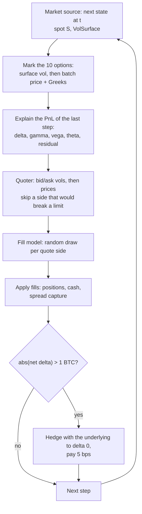
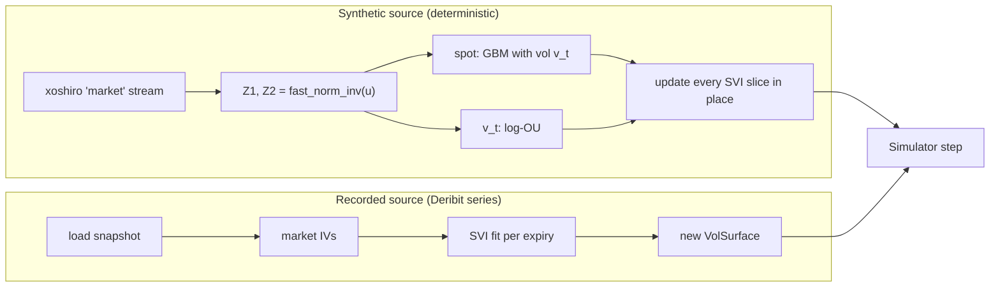

# Market maker model (Part 4)

This page explains, in plain words, what the simulator in `opt::mm` does, every default and its
unit, and what the model leaves out. Results from `mm_sim` are at the end, each with the
command that produced it. Code: `include/opt/mm/`, `src/mm/`, `src/mm_recorded/`,
`tools/mm_sim.cpp`.

## One step of the simulation



The two market sources plug into the same loop. `Simulator::run<MarketSource S>` is a template,
so there is no virtual call per step.



## Pricing and units

- Every option is priced with Black-76 and discount 1 (r = q = 0) through the Part 2
  `greeks_batch(Engine::FastScalar, ...)`: spot = forward F(tau), rate = carry = 0, vol = the
  surface vol at the option's strike and expiry. Delta and gamma are with respect to the forward.
- 1 contract = 1 BTC of notional. Prices are in USD.
- Accounting is in USD, as if the options were linear USD-settled contracts with premium
  price_btc x F. Real Deribit options are inverse (paid and settled in BTC), which adds a BTC
  delta from the premium. That is not modelled.
- The hedge instrument is the index (spot). The model assumes dF = dS. In synthetic mode this
  is exact (F = S). In recorded mode the basis change between the index and each expiry's
  forward lands in the residual bucket.
- No tick rounding, no option fees, no queue position.

Risk numbers, as printed by `mm_sim`:

| Name | Formula | Unit |
|---|---|---|
| net delta | sum q_i delta_i + hedge | BTC |
| gamma_1pct | sum q_i gamma_i x S x 0.01 | BTC of delta per 1% spot move |
| vega/volpt | sum q_i vega_i / 100 | USD per vol point |
| theta/day | sum q_i theta_i / 365 | USD per calendar day |

## Synthetic market

All of it is in `src/mm/synthetic.cpp`.

- Spot, zero drift: S(t+dt) = S(t) exp(-v^2 dt / 2 + v sqrt(dt) Z1).
- ATM vol level v = exp(x), where x follows a log Ornstein-Uhlenbeck process:
  x(t+dt) = x + kappa (ln(vol_mean) - x) dt + xi sqrt(dt) (rho Z1 + sqrt(1 - rho^2) Z2).
  So vol moves with spot (rho < 0: vol rises when spot falls) and is pulled back to its mean.
- Smile per fixed calendar expiry: raw SVI with m = 0, s = 0.1, rho_svi = -0.2,
  b = beta v sqrt(tau) and a = v^2 tau - b s. With these, the ATM total variance is exactly
  v^2 tau. Every step updates every slice in place with tau = expiry - t and forward = S.
- Random numbers: Z1 and Z2 are `fast_norm_inv(uniform01(rng))` on the "market" xoshiro
  stream (stream 1 of the seed). The path uses only `fast_exp`, `fast_log`, `fast_norm_inv` and
  `std::sqrt`, which are built from correctly rounded IEEE operations, so the same seed gives
  the same path bit for bit on every compiler and platform.
- Arbitrage guard: butterfly check per slice and calendar check per adjacent pair, on k in
  [-1.5, 1.5] with 401 points, at construction and every 1,000 steps. A failure at construction
  is a config error (`mm_sim` exits 2). A failure during the run stops it with
  `SimStatus::ArbitrageViolation` (`mm_sim` prints the step and exits 1). The checks allocate
  nothing.

| Default | Value | Unit |
|---|---|---|
| S_0 | 80,000 | USD |
| v_0 | 0.50 | decimal vol |
| vol_mean (exp(theta)) | 0.50 | decimal vol |
| kappa | 5 | per year |
| xi | 1.0 | per sqrt(year) |
| rho (spot, vol) | -0.3 | |
| expiries | 7, 30, 90 | days from start |
| SVI beta, rho, m, s | 0.4, -0.2, 0, 0.1 | |
| dt | 1 | second |
| steps | 86,400 | (1 day; must end before the first expiry) |

## Option set

Per quoted expiry (synthetic: 7 d and 30 d; recorded: the first two fitted expiries of the
series), five options at target log-moneyness k = -0.2, -0.1, 0, 0.1, 0.2: puts below 0, calls
at and above. Synthetic strike = F_0 e^k rounded to 1,000 USD. Recorded strike = the listed
strike nearest to F e^k in the first snapshot (duplicates are dropped). That gives 10 options.

## Quoter

`make_quotes` (`src/mm/quoter.cpp`) is a pure function. With utilisations, each clamped to
[-1, 1], u_inv = q_i / max_position, u_vega = vega / max_vega, u_gamma = gamma_1pct /
max_gamma:

- center vol = fair vol - (k_inv u_inv + k_vega u_vega) / 100
- half spread = (h0 + w_inv |u_inv| + w_vega |u_vega| + w_gamma |u_gamma|) / 100
- bid vol = max(center - half, 0.01), ask vol = center + half
- prices: Black-76 at the bid and ask vols (same batch engine).

So the spread widens as inventory, vega or gamma grows, and a long position lowers both
quotes: the maker then buys less and sells more.

Pre-trade check: a side is not quoted if one fill of the quote size would break any limit
(position, vega, gamma, or net delta before hedging). When several fills land in one step, the
simulator applies them in order (instrument, then bid before ask) and drops a fill that would
break a limit given the fills already applied ("limit-rejected fills"). So the limits hold after
every fill.

| Default | Value | Unit |
|---|---|---|
| quote size | 1 | contract |
| h0 | 1.0 | vol points |
| w_inv, w_vega, w_gamma | 1.0, 1.0, 0.5 | vol points at full utilisation |
| k_inv, k_vega | 0.5, 0.5 | vol points at full utilisation |
| max position | 10 | contracts per option |
| max net delta | 5 | BTC, before hedging |
| max vega | 2,000 | USD per vol point |
| max gamma_1pct | 1.0 | BTC per 1% move |

## Fill model

`src/mm/fill_model.cpp`. For each active quote side, each step:

- distance d = |quote vol - fair vol| in vol points
- intensity lambda = A exp(-kappa d) fills per second
- P(fill in dt) = 1 - exp(-lambda dt); the side fills one quote size if u < P, with u from the
  "fill" xoshiro stream (stream 2). The market path never depends on the strategy.
- dt is the time since the previous state. The first state of a run uses the configured dt in
  synthetic mode and has no fills in recorded mode (no previous state).

| Default | Value | Unit |
|---|---|---|
| A | 1/120 | fills per second per side at zero distance |
| kappa | 1 | per vol point |

Biases, in plain words. This model makes market making look better than it is:

- Fills do not depend on where the price goes next. A real maker is filled more often just
  before the price moves against it (adverse selection). Here it never is.
- Arrivals are independent across options and constant in time.
- The "fair" value used for the distance and for spread capture is the maker's own surface. In
  the synthetic market that surface is the truth, so every fill earns its full half spread.

So the simulated spread capture is an upper bound on what a real maker would earn, and the
total PnL is too.

## Hedger

`src/mm/hedger.cpp`. After fills, if |net delta| > 1 BTC (strict), trade -net delta of the
underlying at spot, which brings net delta to 0, and pay |qty| x spot x 5 / 10,000.

| Default | Value | Unit |
|---|---|---|
| threshold | 1.0 | BTC |
| cost | 5 | bps of notional |

## PnL attribution

`src/mm/pnl.cpp`. For the step from t to t+dt, with the positions q_i and hedge h held over the
step (fills and hedges of step t happen before the market moves), dS = S(t+dt) - S(t),
dsigma_i = the change of option i's own vol at its fixed strike (sticky strike), dt in years,
and Greeks from time t:

| Bucket | Formula |
|---|---|
| delta | (sum q_i delta_i + h) dS |
| gamma | 1/2 sum q_i gamma_i dS^2 |
| vega | sum q_i vega_i dsigma_i |
| theta | sum q_i theta_i dt |
| residual | actual - (delta + gamma + vega + theta), where actual = sum q_i (V_i(t+dt) - V_i(t)) + h dS |
| spread capture | per fill: (fair - price) x qty for a buy, (price - fair) x qty for a sell |
| hedge cost | per hedge, subtracted |

The residual holds what the four first-order terms miss: vanna, volga, higher-order moves,
and (recorded mode) the index-forward basis.

Total (attribution) = delta + gamma + vega + theta + residual + spread capture - hedge cost.

Check: a second, independent path computes the ledger PnL = cash + sum q_i V_i(final) + h
S(final), starting from 0. The two must agree within 1e-6 USD + 1e-12 x (sum of absolute cash
flows: premiums, hedge notionals and costs). The simulator, `mm_sim` (exit 1 if not) and the
tests (`Golden.*`, `Limits.*`, `Recorded.*`) check this.

Doubles, not fixed point. Option values, Greeks and fill prices are real numbers that come out
of a pricing model, and there is no tick grid in this simulator. Fixed point would add a
rounding step at every conversion without making anything exact. Buckets are summed with
`NeumaierSum` (compensated summation), so the sum error does not grow with the number of
steps. A real venue quotes on a tick grid and settles in exact units; production code would
store prices and positions in fixed point (integer ticks and lots) and only use doubles for
model values.

## Latency per quote update

`mm_sim` times steps B (mark: surface vols, batch price + Greeks) and D (quotes: utilisations,
vols, prices, limit checks) for the whole option set with `std::chrono::steady_clock`, records
the nanoseconds in a `LogLinearHistogram<7>` and prints p50, p90, p99, p99.9 and max, plus the
same divided by the option count.

On Apple Silicon `steady_clock` ticks every 41.67 ns, so every sample is a multiple of about
42 ns. Measured with a short program on the dev machine (`mach_timebase_info` and the smallest
non-zero `steady_clock` differences):

```
$ c++ -std=c++20 -O2 /tmp/oe-tick/tick.cpp -o /tmp/oe-tick/tick && /tmp/oe-tick/tick
mach_timebase_info numer 125 denom 3 (41.6667 ns per tick)
smallest non-zero steady_clock deltas (ns): 41 42 83 84 125
```

## Results

Machine: Apple M5 Pro, macOS 26.7.1, Apple clang 21.0.0, `release` preset, built from a clean
`build/release` on 2026-10-17. Full outputs and the build/test log are in
[part4-verification.md](part4-verification.md).

### Synthetic, seed 42, one day of 1-second steps

```
./build/release/tools/mm_sim --mode synthetic --seed 42 --events /tmp/oe-mm-events.csv
```

(`--events` writes the 3,539 fill and 206 hedge lines to a CSV instead of stdout; the rest of
the output is unchanged.)

```
final report
  states 86401  fills bid 1772 ask 1767  hedges 206  limit-blocked sides 3028  limit-rejected fills 0
  steps without surface 0  unlisted instrument-steps 0
  fill hash 0xf358fe64ceb0d637
  final positions: 5 5 -1 8 -5 -2 -4 4 -5 0
  hedge position -1.853332 BTC  final spot 79747.9589  final t 1.000000 d
  final greeks: net delta -0.3736 BTC  gamma_1pct +0.12612 BTC  vega -200.656 USD/volpt  theta -496.504 USD/day
PnL attribution (USD):
  delta                 +371.776047
  gamma                  +82.785988
  vega                  -427.050881
  theta                 -135.043049
  residual               -66.321536
  spread capture     +195736.716711
  hedge cost           -9680.890533
  total              +185881.972746
  ledger total       +185881.972746
  difference       5.821e-11  (tolerance 2.493e-05: ok)
latency per quote update (mark + quote of 10 options, steady_clock ns):
  count 86401  p50 1215  p90 1255  p99 1503  p99.9 1791  max 23792
  per option: p50 121.5  p90 125.5  p99 150.3  p99.9 179.1  max 2379.2
```

What this says:

- Almost all of the PnL is spread capture (195,737 USD) minus hedge cost (9,681 USD). The
  Greek buckets are small because the book stays close to flat and is hedged. This is the
  fill-model bias above: no adverse selection, so every fill earns its half spread. Treat the
  number as an upper bound, not as a strategy result.
- The attribution total and the independent ledger agree to 5.8e-11 USD, far inside the
  2.5e-5 USD tolerance.
- The pre-trade check stopped 3,028 quote sides over the day; no fill was rejected by the
  in-step re-check.
- Latency: the median quote update (pricing and quoting all 10 options) took 1,215 ns, about
  122 ns per option. The p99.9 and max vary between runs on a desktop machine: three runs of
  the same command gave p99.9 of 3,583, 1,791 and 4,735 ns and max of 186,584, 23,792 and
  23,834 ns, while p50 (1,215 ns) and p90 (1,255 ns) were the same in all three. Values are
  multiples of the 41.67 ns clock tick.

### Recorded, the committed Deribit series (6 snapshots, 5 minutes apart)

```
./build/release/tools/mm_sim --mode recorded --series tests/data/deribit/series
```

```
final report
  states 6  fills bid 29 ask 33  hedges 1  limit-blocked sides 0  limit-rejected fills 0
  steps without surface 0  unlisted instrument-steps 0
  fill hash 0x43038f3bd35ba32f
  final positions: -1 0 0 -1 -1 1 -2 1 -2 1
  hedge position -1.464814 BTC  final spot 81398.7200  final t 0.017369 d
  final greeks: net delta -0.9479 BTC  gamma_1pct +0.15810 BTC  vega +23.681 USD/volpt  theta -87.755 USD/day
PnL attribution (USD):
  delta                   -8.091110
  gamma                   +0.120118
  vega                   +12.140367
  theta                   -1.884710
  residual                -2.994049
  spread capture        +399.532758
  hedge cost             -59.605571
  total                 +339.217804
  ledger total          +339.217804
  difference       6.139e-12  (tolerance 1.127e-06: ok)
latency per quote update (mark + quote of 10 options, steady_clock ns):
  count 6  p50 3167  p90 8542  p99 8542  p99.9 8542  max 8542
  per option: p50 316.7  p90 854.2  p99 854.2  p99.9 854.2  max 854.2
```

Notes: the surface was fitted with status Ok for both expiries (19OCT26, 20OCT26) in all 6
snapshots, so no step ran without a surface. With 300 s between snapshots the fill probability
at zero distance is 1 - exp(-300/120) = 0.92 per side, so most sides fill at every step.
Six latency samples are too few for tail percentiles; the recorded latency (which includes
cold caches after each JSON load and fit) is shown only for completeness. The recorded run uses
the libm-based IV solver and SVI fits, so it is not compared bit for bit like the synthetic
golden run.
